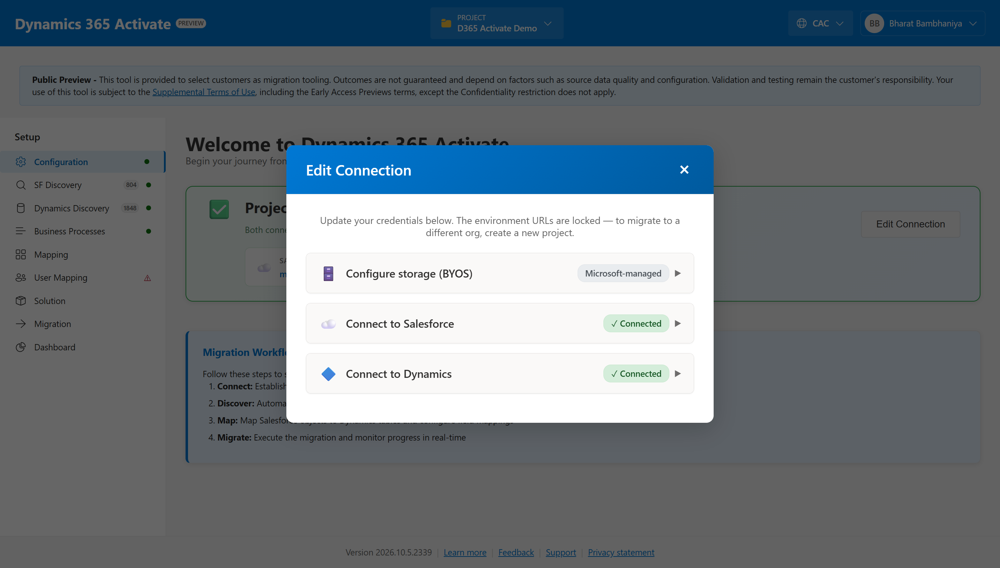

# Exercise 1: Review the project configuration

In this exercise, you sign in to Dynamics 365 Activate, confirm that your Salesforce and Dynamics connections are active, and learn the four-stage migration workflow that the rest of this lab follows.

## Task 1: Open the project and read the migration workflow

Dynamics 365 Activate organizes all migration work into a **project**. A project holds the connection to one Salesforce org and one Dynamics 365 environment, so you start by confirming the project is ready.

1. In your browser, open the Dynamics 365 Activate URL provided in your lab environment, and then sign in with the lab credentials.

1. In the top bar, confirm that the project selector shows **D365 Activate Demo**.

    > **Note:** The **Public Preview** banner under the top bar reminds you that outcomes depend on source data quality and that you are responsible for validation and testing.

1. In the left navigation, select **Configuration** to open the welcome page.

1. In the **Project Configured** card, confirm that the message reads **Both connections are active and ready for migration**.

    

1. In the **Migration Workflow** panel, read the four stages: **Connect**, **Discover**, **Map**, and **Migrate**.

    > **Why this matters:** The left navigation follows these four stages from top to bottom, so you can work through the tool in order.

===

## Task 2: Inspect the connection settings (read only)

The **Edit Connection** dialog shows how the project connects to Salesforce, Dynamics 365, and storage. You open it only to see the available options, and you close it without changing anything.

1. On the **Project Configured** card, select **Edit Connection** to open the dialog.

1. In the **Edit Connection** dialog, review the three rows: **Configure storage (BYOS)**, **Connect to Salesforce**, and **Connect to Dynamics**.

    

    > **Note:** The environment URLs are locked. To migrate to a different org, you create a new project instead of editing this one.

1. In the upper-right corner of the dialog, select **×** to close it without making changes, so the connection stays intact for the next exercises.

    > **Important:** Do not expand the Salesforce or Dynamics rows in this lab, because they display credential fields.

**Checkpoint:** The **Edit Connection** dialog is closed, and the **Configuration** page is displayed with both connections shown as active.
