# Exercise 1: Create your workspace, project, and connections

In this exercise, you sign up for Dynamics 365 Activate, create a workspace and a migration project, choose where migration data is staged, and connect your Salesforce and Dynamics 365 environments. You then start discovery, which every later exercise builds on.

> **Note:** Use the credentials and connection values provided in your lab environment. Never enter customer credentials or production secrets in this lab.

## Task 1: Create a workspace

A **workspace** groups the migration projects of one team, so you create it before your first project.

1. In your browser, go to `https://migrate.dynamics.cloud.microsoft/signup`.

    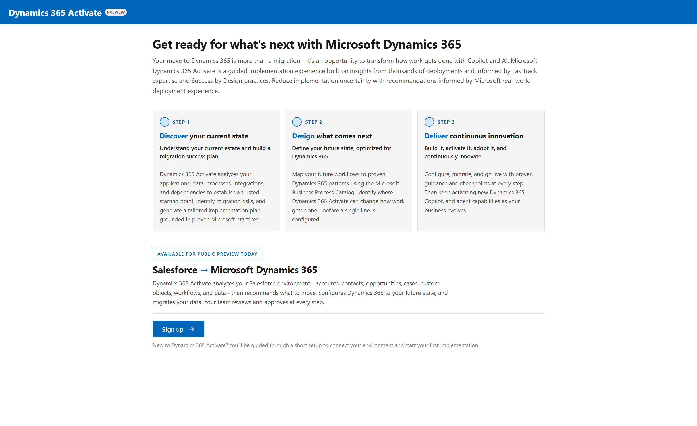

1. Select **Sign up**, and then sign in with your lab account if you are prompted.

1. On the **Tell us about your Dynamics 365 initiative** form, confirm that **Project type** is **Legacy System Migration** and **Legacy source** is **Salesforce**.

    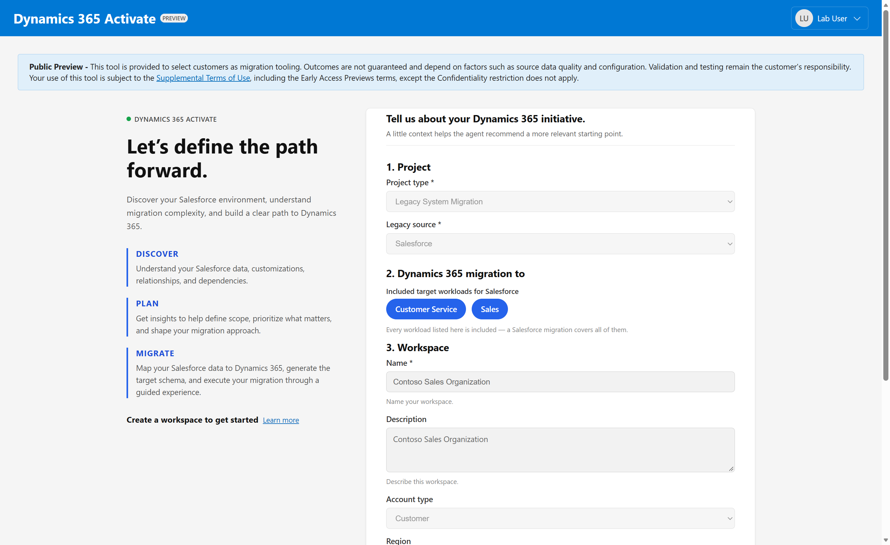

1. In **Workspace**, enter **Ignite Lab 700** as the **Name** and as the **Description**, and then review **Account type**, **Region**, and **Purpose**.

    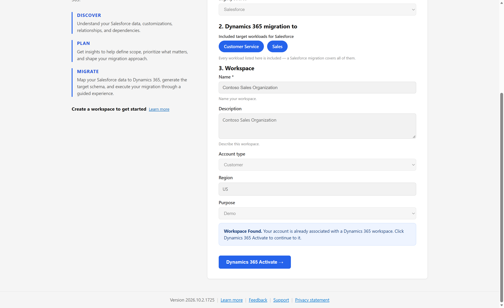

    > **Note:** If your account already belongs to a workspace, the form shows a **Workspace Found** message and skips this step, as in the screenshot. Select **Dynamics 365 Activate** to continue to that workspace, and use its name wherever this lab says **Ignite Lab 700**.

1. Select **Dynamics 365 Activate** to create the workspace and open the **Migration Projects** page.

===

## Task 2: Create a project

A **project** holds the connection to one Salesforce org and one Dynamics 365 environment, so every migration starts with a new project.

1. On the **Migration Projects** page, confirm that the **Workspace** list shows your workspace.

    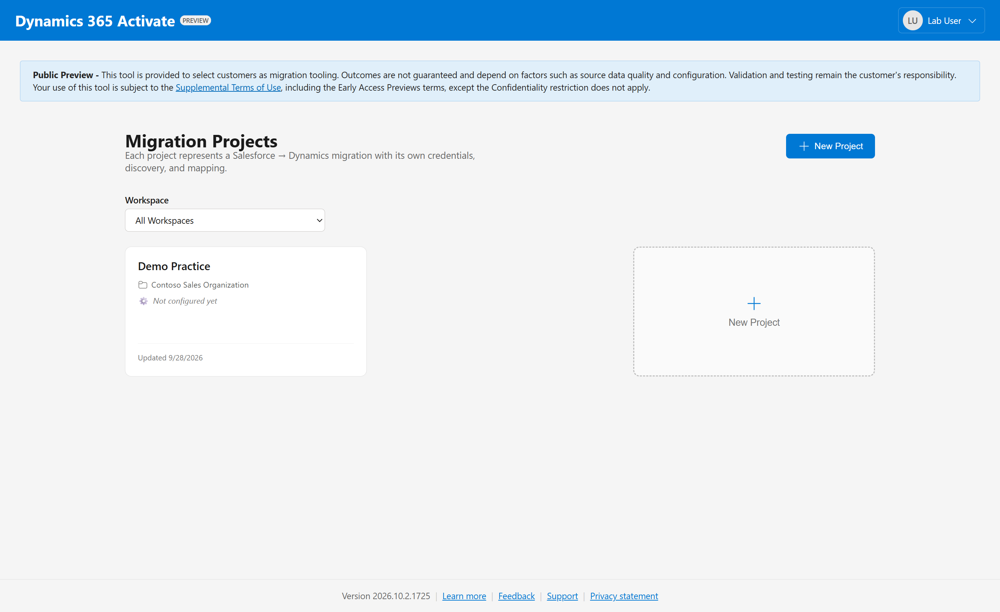

1. Select **New Project** to open the **Create New Project** dialog.

    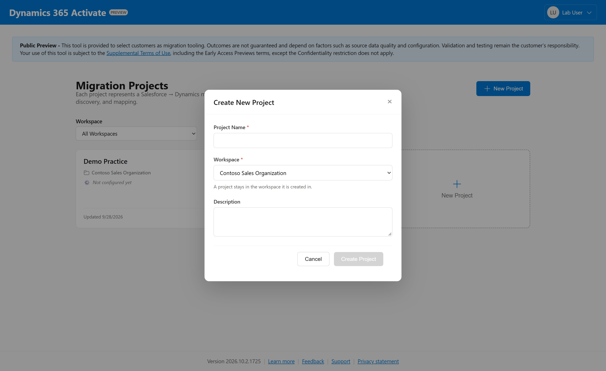

1. In **Project Name**, enter **Ignite Lab 700 SFDC Migrate**, and then confirm that **Workspace** shows your lab workspace.

    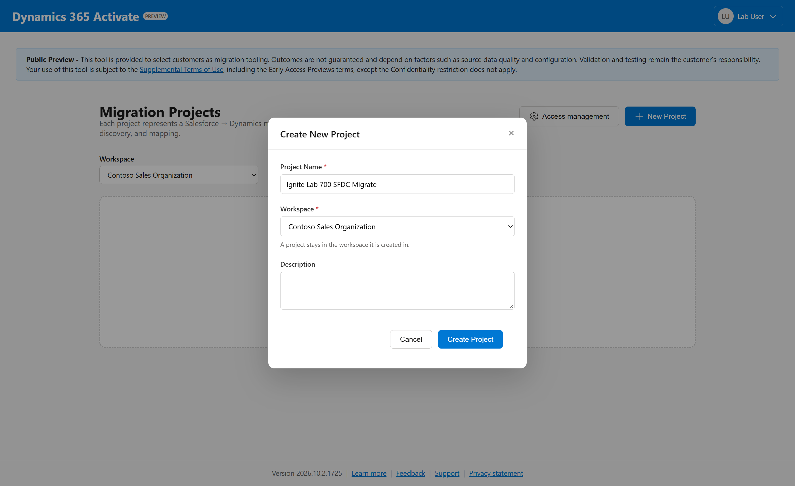

1. Select **Create Project**, and then confirm that the project selector in the top bar shows your new project.

    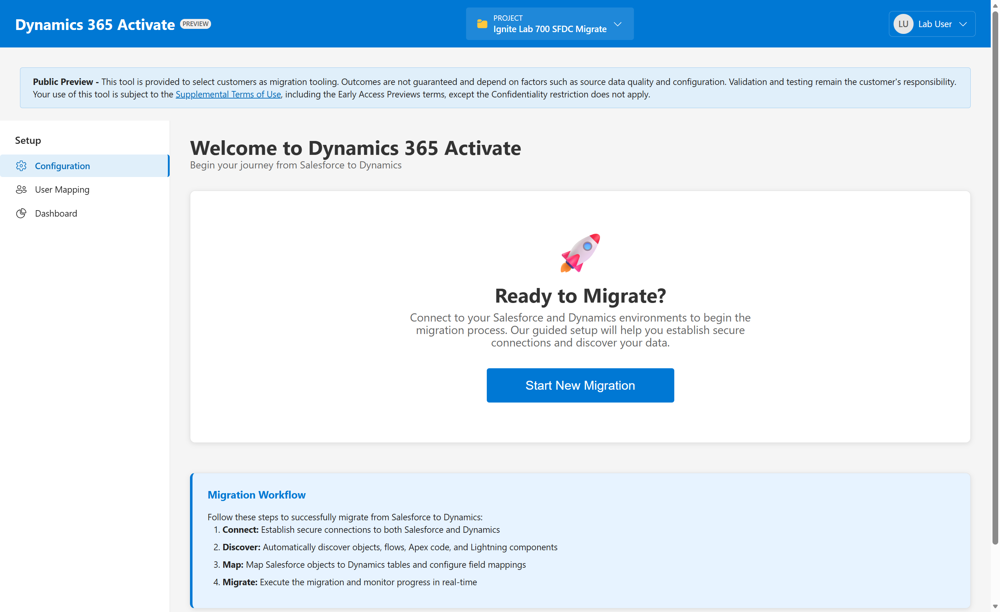

    > **Important:** Do not use a name or identifier that contains credentials or customer information.

===

## Task 3: Explore bring your own storage

Migration data passes through a temporary staging location while records move from Salesforce to Dynamics 365, and you decide who owns that location.

1. On the welcome page, select **Start New Migration** to open the **Start New Migration** dialog.

    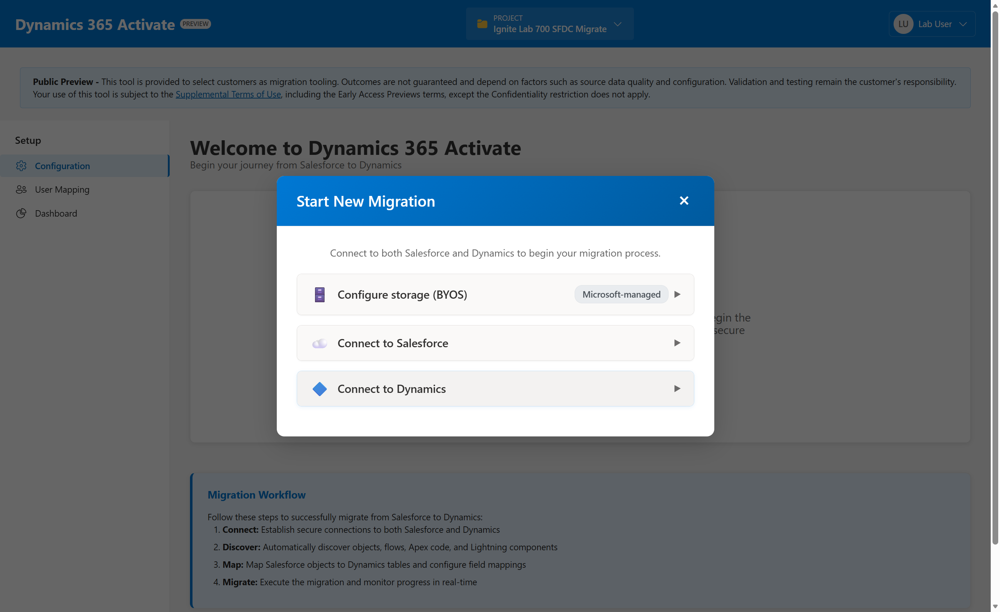

1. Expand **Configure storage (BYOS)**, and then read the choices **Microsoft-managed storage (default)** and **Use my own Azure Storage account**.

    ")

1. Keep **Microsoft-managed storage** selected, and do not enter a Storage SAS URL.

| Option | Why it makes sense |
|--------|--------------------|
| Microsoft-managed | You do not provision Azure Storage or manage SAS access, so you can concentrate on discovery, mapping, and migration. |
| Bring your own storage | You control the staging account, access, and lifecycle policies, but you must own the configuration, permissions, and operations. |

**Checkpoint:** Your new project is selected, **Microsoft-managed** storage is selected, and no storage credentials are saved.

===

## Task 4: Connect Salesforce and run discovery

Discovery reads the metadata of your Salesforce org, so you connect it first.

1. In the **Start New Migration** dialog, expand **Connect to Salesforce**.

    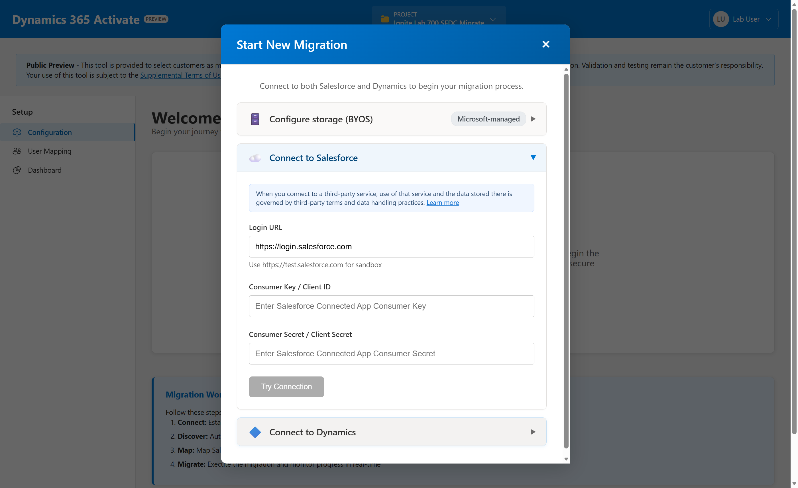

1. Enter the **Login URL**, **Consumer Key / Client ID**, and **Consumer Secret / Client Secret** that your facilitator provided.

    > **Note:** Use `https://test.salesforce.com` or your sandbox **My Domain** URL for a sandbox org.

1. Select **Try Connection**, and then wait until **Connect to Salesforce** shows **Connected**.

1. After the Dynamics 365 connection is set up in the next task, select **SF Discovery** in the left navigation, and then select **Start Discovery** to begin reading your Salesforce metadata.

    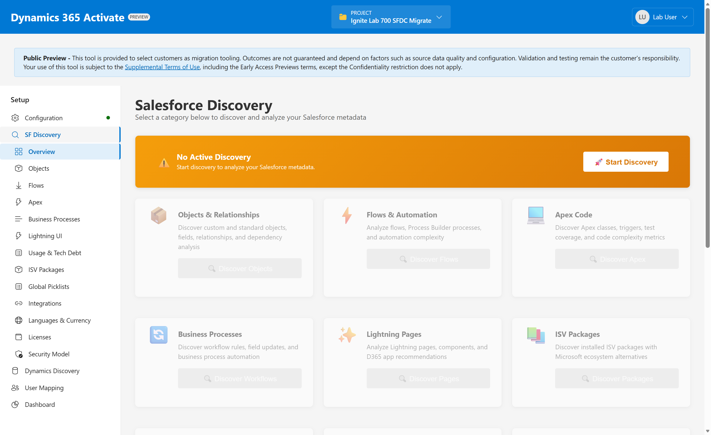

1. Wait while the **Fetching Discovery Data** panel completes each category, such as **Objects**, **Flows**, and **Apex**.

    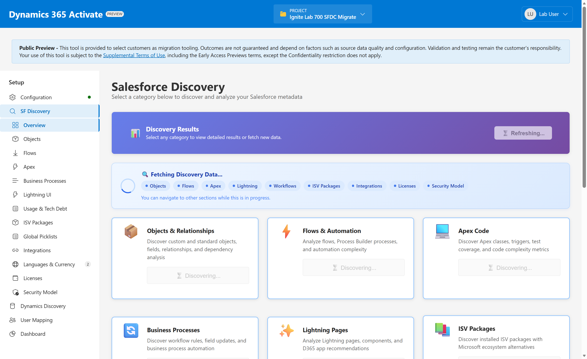

    > **Why this matters:** You can open other pages while discovery runs, and the counts in the left navigation fill in as each category finishes.

1. When discovery finishes, confirm that the **SF Discovery** badge in the left navigation shows a total count and that every category card shows **View** instead of **Discover**.

    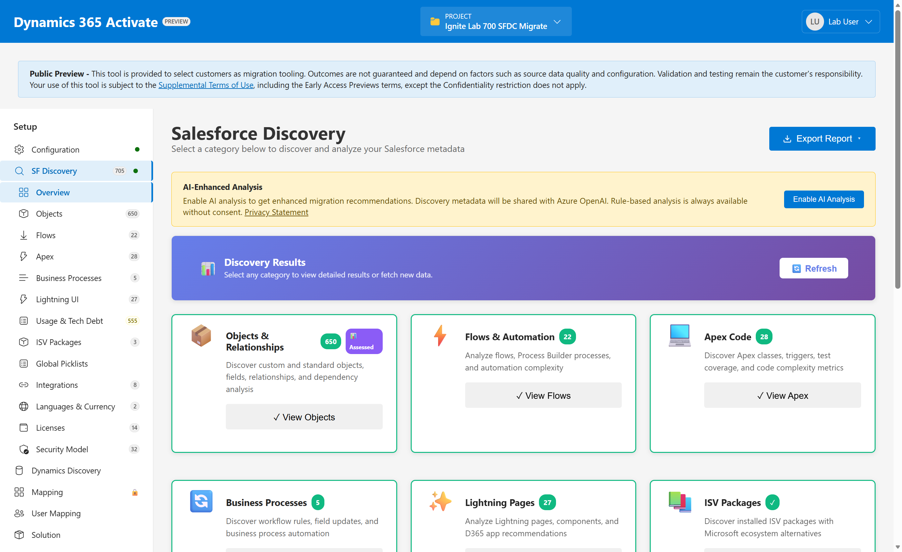

1. In the **AI-Enhanced Analysis** banner, read the message, and then select **Enable AI Analysis** to get AI recommendations for Flows, Apex, and Lightning components.

    > **Important:** AI analysis shares discovery metadata, such as object, flow, and class names and code, with Azure OpenAI. Treat that metadata as potentially sensitive, and use only the approved lab org.

1. Wait until the banner reports that AI analysis is complete.

    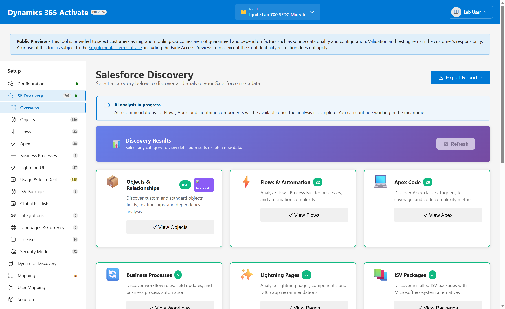

===

## Task 5: Connect Dynamics 365 and run discovery

Dynamics 365 is the migration target, so Activate also needs to read its tables and columns.

1. In the left navigation, select **Configuration**, and then select **Edit Connection**.

1. In the dialog, expand **Connect to Dynamics**, and then review the **Environment URL**, **Tenant ID**, **Client ID (App Registration)**, and **Client Secret Value** fields.

    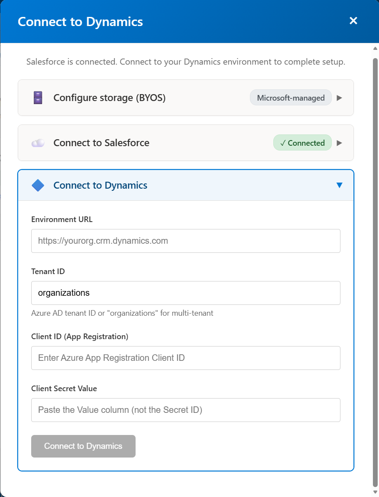

1. Enter the **Environment URL**, **Tenant ID**, **Client ID**, and **Client Secret Value** that your facilitator provided, and then select **Connect to Dynamics**.

    > **Important:** Confirm that the environment is your assigned non-production target before you continue.

1. When the message **Successfully connected to Dynamics** appears, select **Go to Dynamics Discovery** to start discovery of the Dynamics 365 environment.

    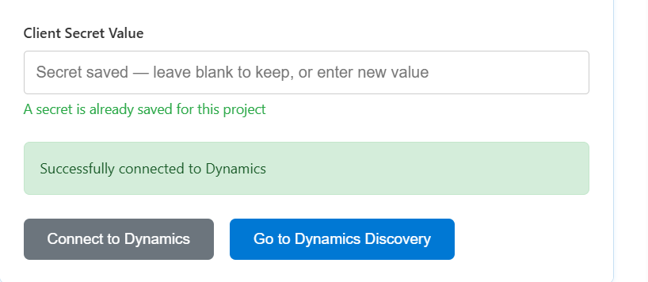

1. In the left navigation, select **Configuration**, and then confirm that the **Project Configured** card shows both the Salesforce and Dynamics environments.

    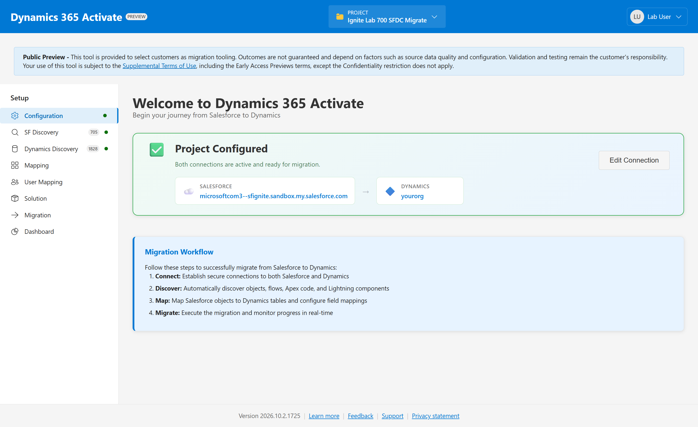

1. In the **Migration Workflow** panel, read the four stages: **Connect**, **Discover**, **Map**, and **Migrate**.

    > **Why this matters:** The left navigation follows these four stages from top to bottom, so you can work through the tool in order.

**Checkpoint:** Both connections show as connected, Salesforce discovery and AI analysis are complete, and Dynamics discovery is running or complete.
