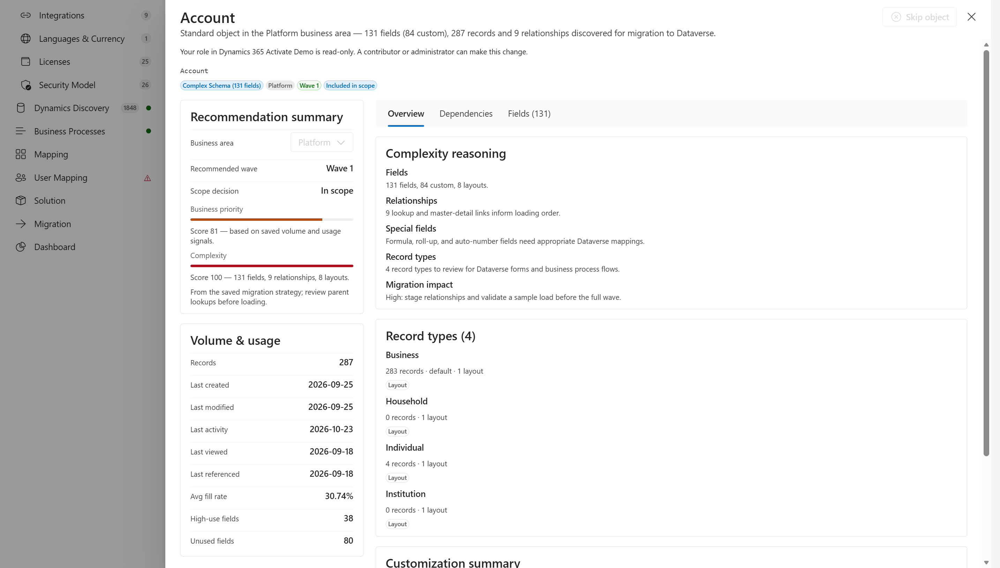
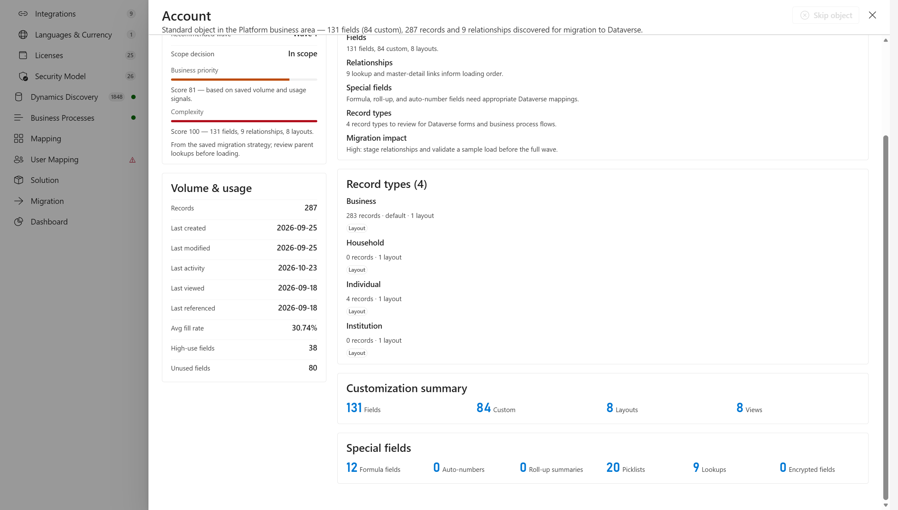
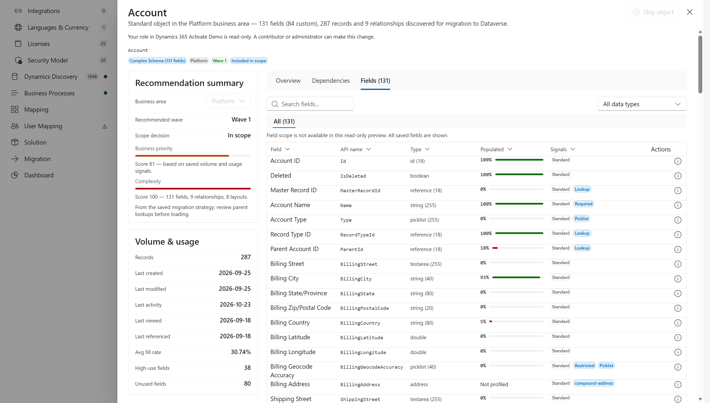

# Exercise 3: Inspect the Account object

In this exercise, you open the Salesforce **Account** object in the discovery results and review its recommended wave, complexity, record types, dependencies, and fields. Account is the object you migrate in the last exercise, so you need to know what it contains first.

## Task 1: Open the Account details

The object details panel combines the scoring, volume, and field analysis for a single object, so you can judge how risky its migration is.

1. In the left navigation, select **SF Discovery**, and then select **Objects**.

1. Scroll down to the **Wave 1** group, and then locate the **Account** row.

1. In the **Account** row, select **Open details** to display the details panel on the right side of the page.

    > **Why this matters:** Opening the panel is a read-only action, and it does not change the scope of the migration.

1. In the panel header, confirm the description reads **Standard object in the Platform business area**.

1. In the **Recommendation summary** card, note the **Recommended wave**, the **Scope decision**, the **Business priority** score, and the **Complexity** score.

    

1. On the **Overview** tab, review **Complexity reasoning** and the four **Record types** (**Business**, **Household**, **Individual**, and **Institution**).

    > **Note:** Account has 131 fields and 9 relationships, so Activate recommends that you validate a sample load before the full wave.

1. Scroll down in the panel to review the **Customization summary**.

    

===

## Task 2: Review dependencies and fields

The **Dependencies** and **Fields** tabs show which other objects Account relies on and which fields hold data, which drives your mapping decisions later.

1. In the details panel, select the **Dependencies** tab to display the **Entity relationship dependency map**.

    > **Note:** The map shows the Salesforce tables connected to Account, such as Contact, RecordType, and User, with the lookup field that carries each relationship.

    

1. In the details panel, select the **Fields (131)** tab to display every Account field.

1. In the **Fields** table, review the **Field**, **API name**, **Type**, **Populated**, and **Signals** columns.

    

    > **Why this matters:** Fields that are rarely populated are candidates to skip, which reduces the work in the mapping stage.

1. In the upper-right corner of the panel, select **Close** (**X**) to close the details panel.

    > **Important:** Do not select **Skip object**. It is disabled for your role, and it would move Account out of the migration scope.

**Checkpoint:** The details panel is closed, and you can describe Account's wave, complexity, record types, and field population.
