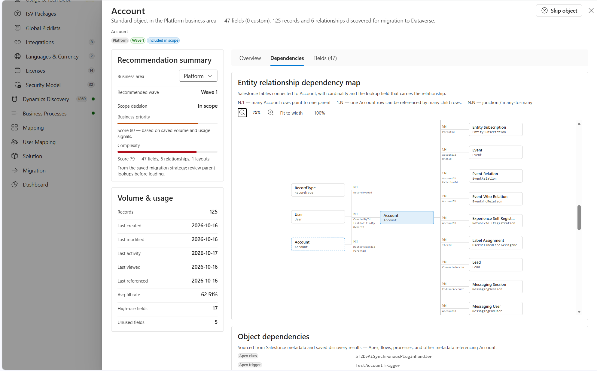

# Exercise 3: Inspect the Account and Contact objects

In this exercise, you open the Salesforce **Account** object in the discovery results and review its complexity, record types, dependencies, and fields. You then compare it with **Contact**, the other object you migrate. Both objects are migrated in the last two exercises, so you need to know what they contain first.

## Task 1: Open the Account details

The object details panel combines the scoring, volume, and field analysis for a single object, so you can judge how risky its migration is.

1. In the left navigation, select **SF Discovery**, and then select **Objects**.

1. Scroll down to the **Wave 1** group, and then locate the **Account** row.

1. In the **Account** row, select **Open details** to display the details panel on the right side of the page.

    > **Why this matters:** Opening the panel is a read-only action, and it does not change the scope of the migration.

1. In the panel header, confirm the description reads **Standard object in the Platform business area**.

1. In the **Recommendation summary** card, note the **Scope decision**, the **Business priority** score, and the **Complexity** score.

    

1. On the **Overview** tab, review **Complexity reasoning**, **Volume & usage**, and the **Record types**.

    > **Note:** Review parent lookups and record types before you load Account, because Contact and other objects depend on it.

===

## Task 2: Review Account dependencies and fields

The **Dependencies** and **Fields** tabs show which other objects Account relies on and which fields hold data, which drives your mapping decisions later.

1. In the details panel, select the **Dependencies** tab to display the **Entity relationship dependency map**.

    

    > **Note:** The map shows the Salesforce tables connected to Account, such as Contact, RecordType, and User, with the lookup field that carries each relationship.

1. In the details panel, select the **Fields** tab to display every Account field.

1. In the **Fields** table, review the **Field**, **API name**, **Type**, **Populated**, and **Signals** columns.

    

    > **Why this matters:** Fields that are rarely populated are candidates to skip, which reduces the work in the mapping stage.

1. In the upper-right corner of the panel, select **Close** (**X**) to close the details panel.

    > **Important:** Do not select **Skip object**, because it would move Account out of the migration scope.

===

## Task 3: Compare with the Contact object

Contact looks up to Account, so the two objects have to be loaded in the right order.

1. In the **Objects** list, locate the **Contact** row, and then compare its **Business priority**, **Complexity**, and wave with the Account row.

1. In the **Dependencies** map of Account, find the **Contact** box to see how the two objects connect.

    > **Note:** You review the Contact details in full in Exercise 6: [Migrate the Contact records](06-contact-migration.md).

**Checkpoint:** The details panel is closed, and you can describe the complexity, record types, and field population of Account.
