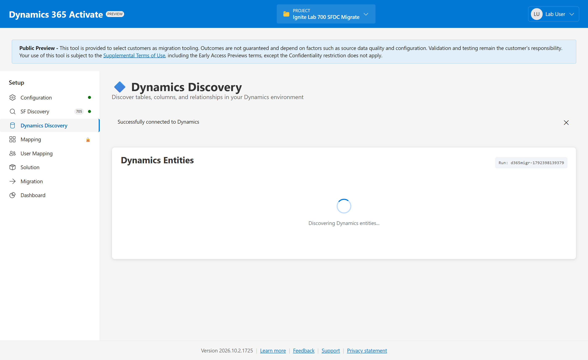
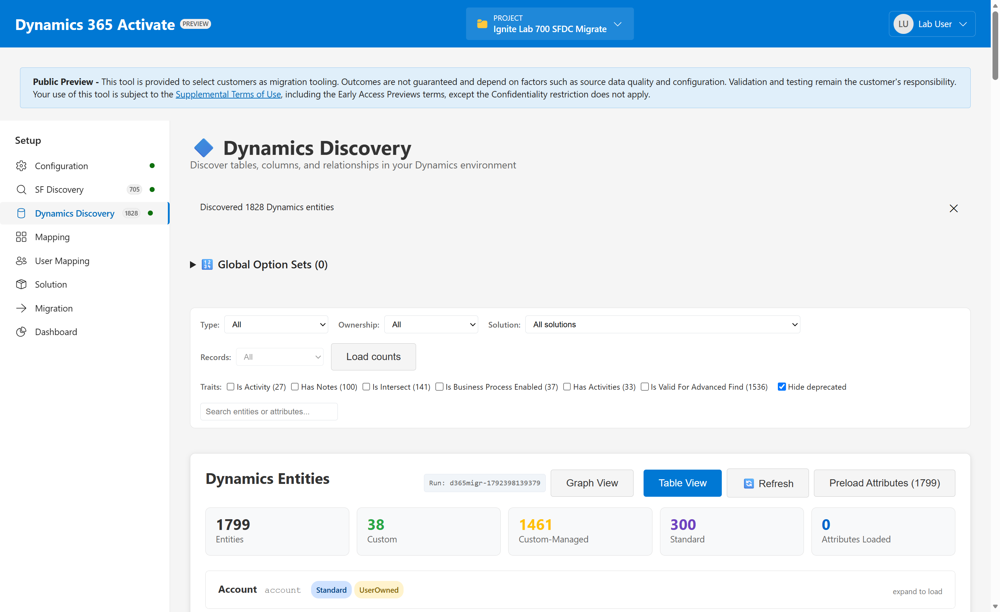
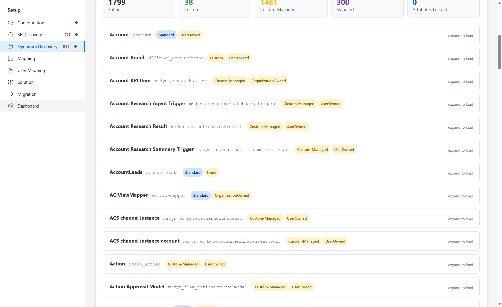
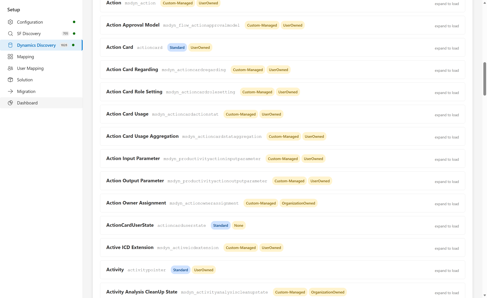
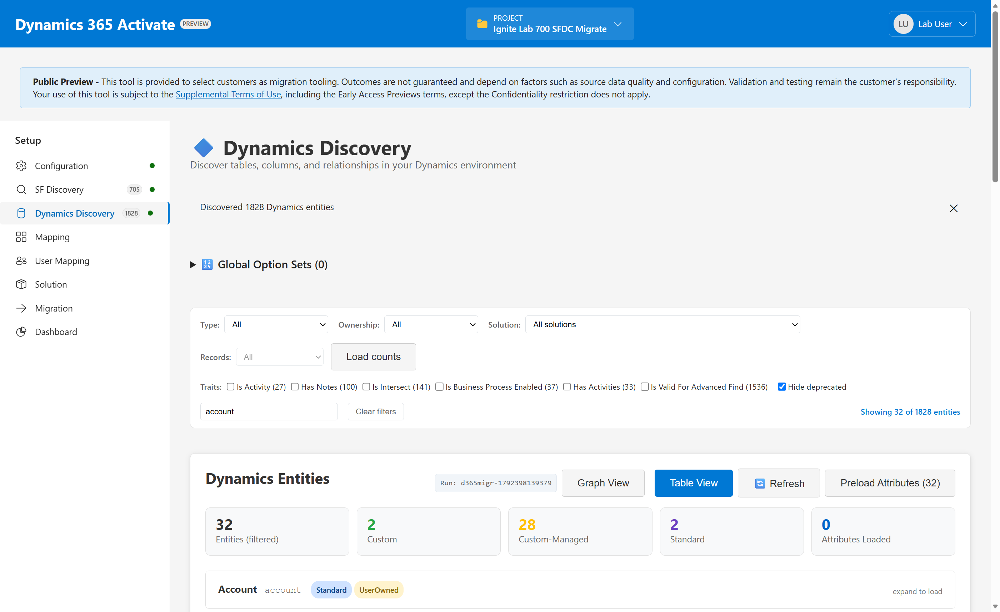
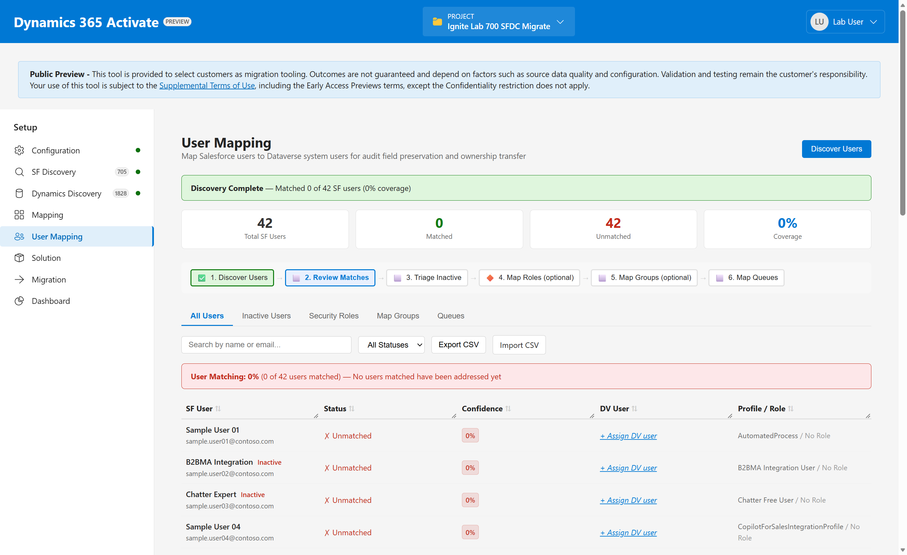
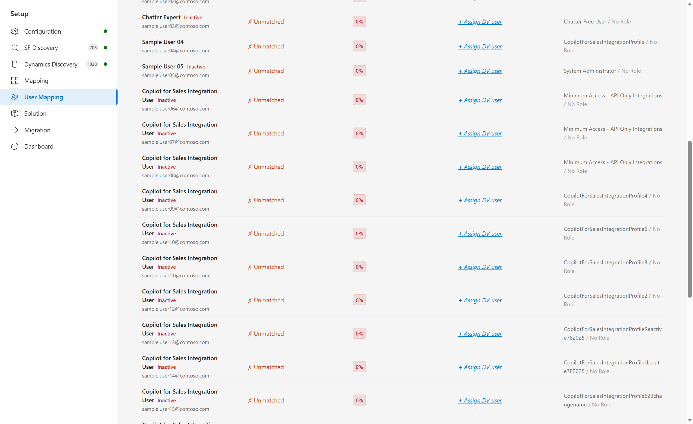
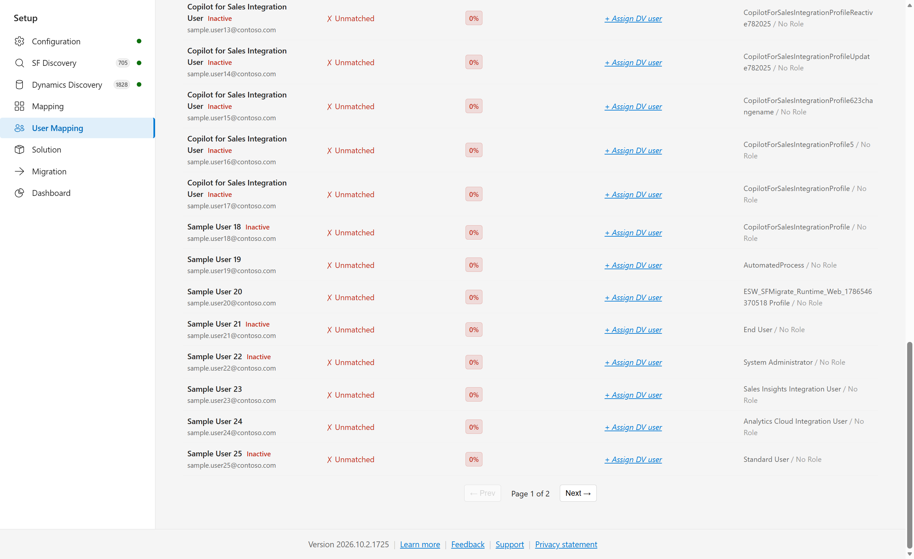

# Exercise 4: Review Dynamics and user mapping

In this exercise, you review the target Dynamics 365 environment and the Salesforce-to-Dynamics user matching. These two pages prepare the target side of the migration.

## Task 1: Explore Dynamics Discovery

**Dynamics Discovery** reads the tables, columns, and relationships in your Dynamics 365 environment, so Activate can match Salesforce objects to existing tables such as `account`.

1. In the left navigation, select **Dynamics Discovery** to open the page.

    > **Note:** The first time you open the page, Dynamics discovery runs automatically and shows **Discovering Dynamics entities**.

    

1. When discovery finishes, review the filters at the top, which include **Type**, **Ownership**, **Solution**, and the **Traits** check boxes.

1. In the **Dynamics Entities** card, review the tiles for total entities and for custom, custom-managed, and standard entities.

    

1. Scroll down to the entity list to review the Dynamics 365 tables that were discovered.

    

    

1. In **Search entities or attributes**, enter **account**, and then locate the **Account** (`account`) table, which is marked **Standard** and **UserOwned**.

    

1. Select **Clear filters** to reset the entity list.

    > **Important:** Do not select **Refresh**, **Load counts**, or **Preload Attributes**, because they query your Dynamics environment.

===

## Task 2: Review user mapping

**User Mapping** matches Salesforce users to Dynamics 365 system users, so record ownership and audit information can be carried across during migration. In this lab you do not map all the users, but it is a prerequisite if you want to preserve the original **Created By** and **Modified By** values.

1. In the left navigation, select **User Mapping** to open the page.

1. Select **Discover Users** to read the Salesforce users, and then wait for the **Discovery Complete** message.

1. Review the summary tiles for **Total SF Users**, **Matched**, **Unmatched**, and **Coverage**.

1. Review the six-step progress bar, from **1. Discover Users** to **6. Map Queues**, to see the order of the user mapping work.

    

1. Scroll down to review the **SF User**, **Status**, **Confidence**, **DV User**, and **Profile / Role** columns.

    

    

    > **Why this matters:** A coverage of 0% means that ownership of migrated records cannot be preserved until users are matched.

1. Notice the **All Users**, **Inactive Users**, **Security Roles**, **Map Groups**, and **Queues** tabs for the other mapping steps.

    > **Important:** Do not select **Assign DV user** or **Import CSV** in this lab.

**Checkpoint:** You can explain what the two pages contribute to the migration.
