# Exercise 5: Migrate the Account records

In this exercise, you map the Salesforce **Account** object to the existing Dynamics 365 `account` table, deploy the schema changes, run the migration, and validate the result on the dashboard.

> **Note:** The mapping, solution, and migration screens in this exercise change data in your Dynamics 365 environment. Run them only against the non-production target provided for this lab.

## Task 1: Generate and review the Account mapping

The **Mapping Workbench** is where you generate and review the field mappings between Salesforce and Dynamics 365, so you share every mapping detail of Account before any data moves.

1. In the left navigation, select **Mapping** to open the **Mapping Workbench**.

1. Review the toolbar buttons in the **Generate & Review Mappings** card, such as **Auto-Generate Mappings**, **Load Mappings**, **Preflight Check**, **Templates**, **Reuse Hub**, **Annotations**, **Export**, **Import**, **History**, and **Global Picklists**.

    

    > **Note:** The workbench shows **No Mappings Yet** until you generate mappings.

1. In the toolbar, select **Auto-Generate Mappings** to create field mappings for the Salesforce objects.

    

1. When generation finishes, review the **Readiness overview** and the **Table mappings** list. The **Existing tables** tab lists every Salesforce object that Activate mapped, but this lab migrates only **Account** and **Contact**.

1. On the **Existing tables** tab, select **Select all**, and then clear the check boxes for the **Account → account** and **Contact → contact** rows.

1. Select **Move to out of scope** to move all the other objects out of scope in one step, and then confirm that the **Existing tables** tab shows only **Account** and **Contact**.

    > **Important:** All other tables must stay out of scope for this migration. If another table appears on the **Existing tables** tab, select its check box, and then select **Move to out of scope**.

1. In the **Account → account** row, select **Open details** to open the **Account mapping details**.

    

1. On the **Field mappings** tab, filter the field types by **Picklist**, and then review the two existing fields and the new picklist field.

    

1. Open the new picklist field, and then notice that Activate automatically created values where it found no match.

    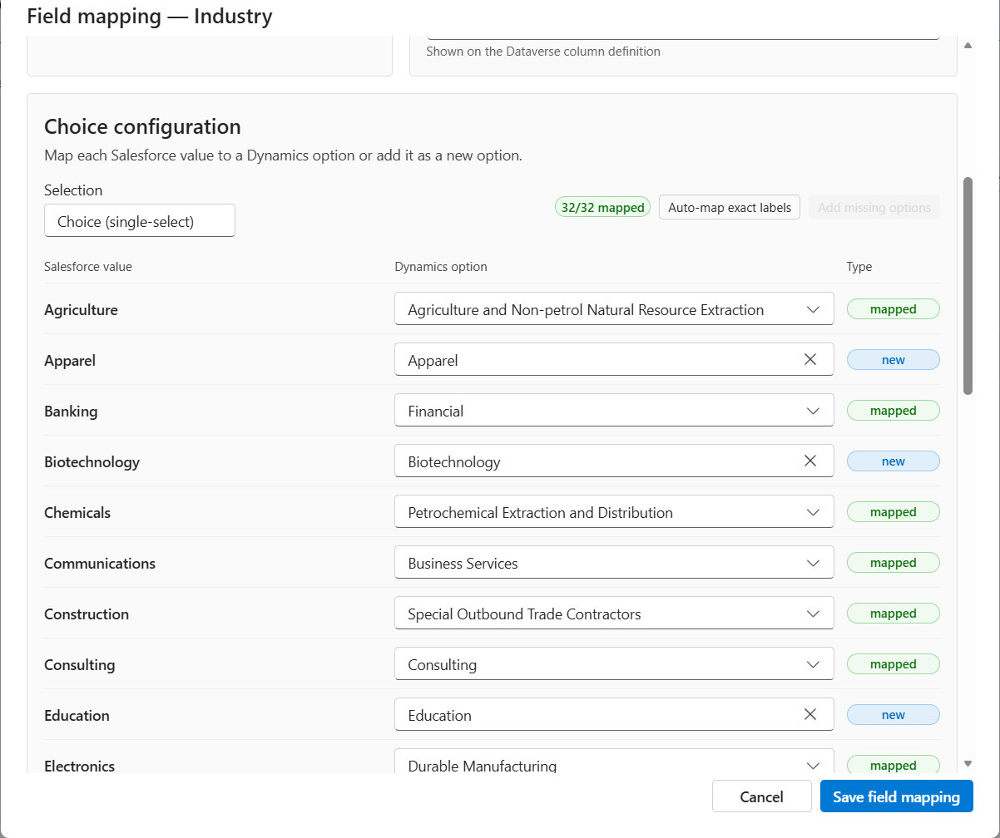

1. Filter on **owner**, and then select the option to move the **Owner ID** field out of scope.

    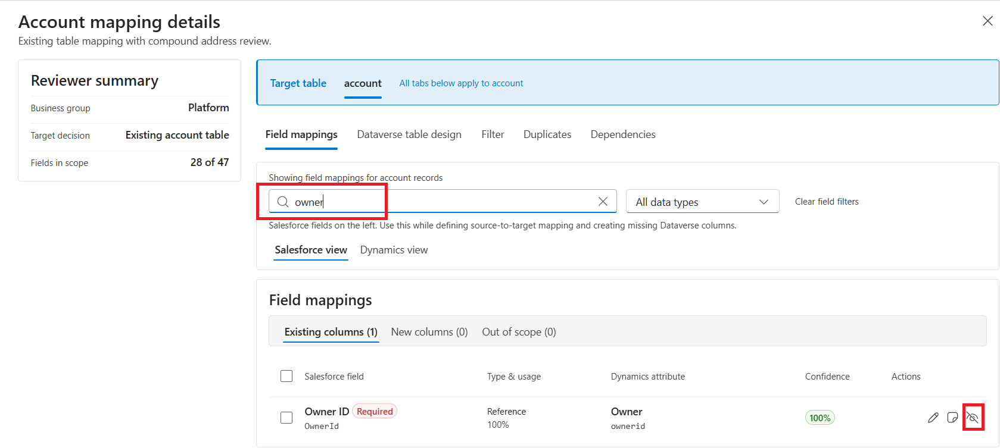

    > **Why this matters:** In this lab you do not map the users, so the owner lookup cannot be resolved during migration.

1. Explore the other tabs of the **Account mapping details**, starting with **Dataverse table design**.

    

1. Select the **Filter** tab. The **Record filter** limits which Account records are migrated, so you can move a subset of the data, for example a pilot batch, instead of everything. By default there are no conditions, and every Account record in scope migrates.

1. To see how a filter works, select **Add condition**, set **Field** to **BillingCountry**, leave **Operator** as **equals**, and enter **United States** as the **Value**. The **Generated SOQL preview** shows `WHERE BillingCountry = 'United States'`.

1. Select **Validate & preview count**, and then notice the message **5 of 125 Account records match**.

    

    > **Why this matters:** A filter applies to the Account extraction step only, so records that don't match are never read or migrated. You can also use **Row limit** to cap the number of records, or switch to **SOQL query** to write the filter yourself.

    > **Important:** Select **Clear** and do not select **Save filter**, because this lab migrates all Account records.

1. Select the **Duplicates** tab. Salesforce often holds the same company more than once, for example "Harbor Point Logistics", "HARBOR POINT LOGISTICS", and "harbor point logistics". **Remove duplicate records** lets you decide which records describe the same real-world thing, and which one to keep, so that only one record is written to the Dynamics 365 `account` table.

1. Set **Remove duplicate records** to **On**, and then define the rule in two parts:
    - In **Two records are the same when**, select **Add** > **Add row**, set **Field** to **Name**, leave **Operator** as **Same, ignoring capitals and surrounding spaces**, and leave **Value (Dataverse column)** as **Account Name (name)**.
    - In **When records match, keep**, select **Add rule**, set **Salesforce field** to **CreatedDate**, and set **Prefer** to **Prefer the oldest**.

    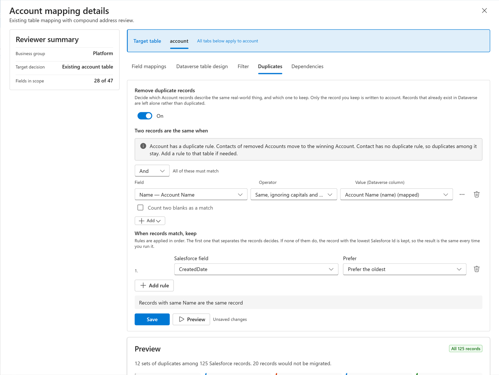

1. Select **Preview**, and then review the result: **12 sets of duplicates among 125 Salesforce records. 20 records would not be migrated.**

    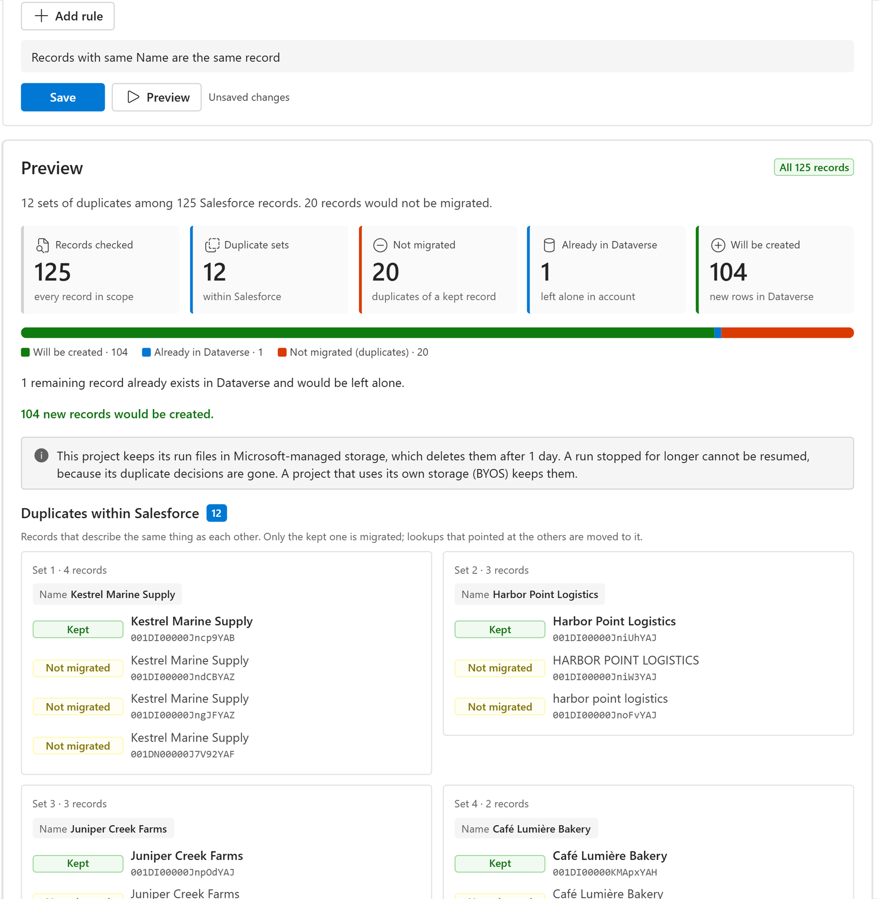

    > **Why this matters:** Each set shows the **Kept** record and the **Not migrated** records. Lookups that pointed at a removed record, such as Contacts of a removed Account, are moved to the kept record, so no relationships are lost. Records that already exist in Dataverse are left alone, so a rerun doesn't create duplicates.

    > **Important:** Set **Remove duplicate records** back to **Off** and do not select **Save**, because this lab migrates all Account records.

1. Select the **Dependencies** tab to see the tables that Account relates to, whether each link is still in scope, and the Dynamics attribute that receives it.

    

1. Close the details, and then select **Preflight Check** in the toolbar to confirm that no blocking issues remain before migration.

    

===

## Task 2: Deploy the Account schema changes

Account already exists in Dynamics 365, but some fields are new or changed, so you select Account and deploy those changes before you migrate.

1. In the left navigation, select **Solution** to open the **Dynamics Solution Generator**.

1. At the top of the page, review the tiles for **Objects Selected**, **Total Fields**, **New Tables**, **Missing Columns**, and **Already in Dynamics**.

    

1. In the **Missing Columns** table, select the check box in the **Account** row.

    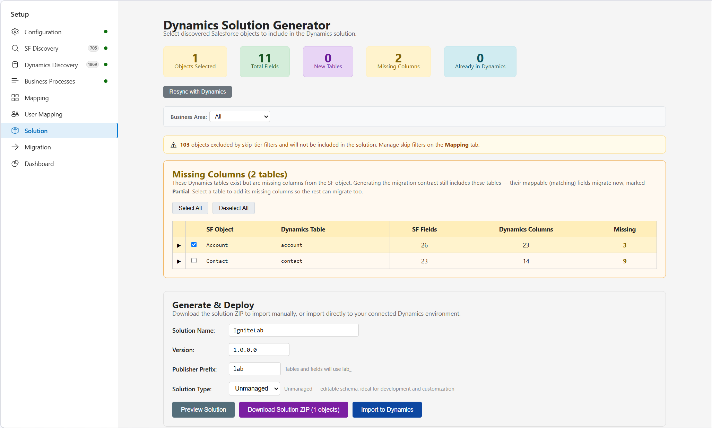

    > **Note:** The **Missing Columns** table lists Dynamics tables that exist but lack some Salesforce columns. Selecting a table adds its missing columns so the rest can migrate too.

1. Scroll down to the **Generate & Deploy** section, and then review the solution settings.

    - **Solution Name:** `IgniteLab`
    - **Version:** keep the default value
    - **Publisher Prefix:** `lab`
    - **Solution Type:** `Unmanaged`

    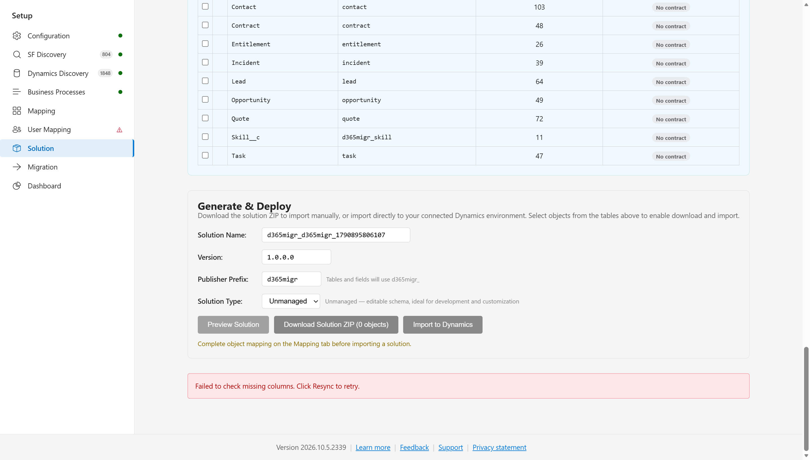

1. Select **Import to Dynamics** to import the solution into your connected Dynamics 365 environment.

    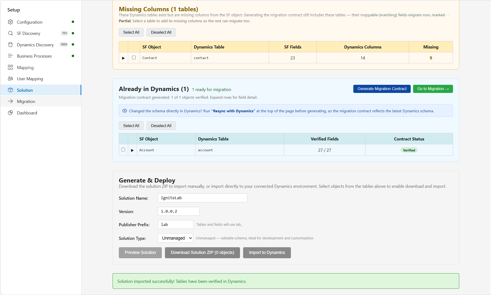

1. Confirm that the message **Solution imported successfully** appears and that **Already in Dynamics** shows the Account contract status as **Verified**.

    > **Why this matters:** The **Migration** page stays blocked until the solution import is complete and the migration contract exists.

===

## Task 3: Run the Account migration

The **Migration** page runs the data transfer for all mapped objects, so you review the settings, validate the mapping, and then start the run.

1. In the left navigation, select **Migration** to open the **Data Migration** page.

1. In **Migration Settings**, select **Preserve Audit Fields** to keep the original Salesforce timestamps and user attribution.

    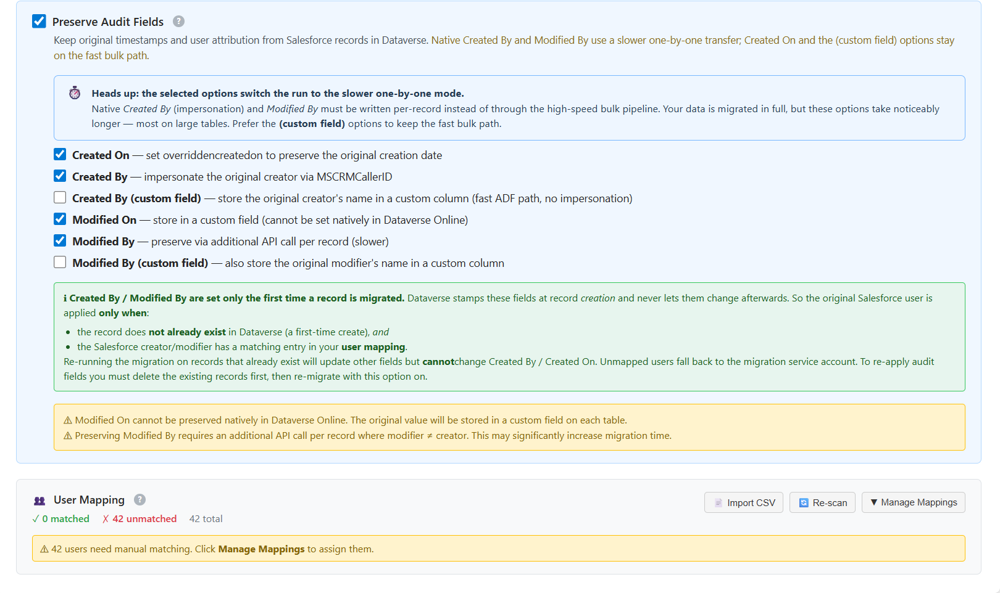

1. Select **Created On**, **Created By (custom field)**, **Modified On**, and **Modified By (custom field)**, and leave the native **Created By** and **Modified By** options cleared.

    

    > **Note:** To preserve the native **Created By** and **Modified By** values you must map the users first. In this lab you store them in custom fields and update **Created On**.

    > **Why this matters:** The native **Created By** and **Modified By** values use a slower one-by-one transfer, so select them only when you need that history.

1. Scroll down to the **Start Migration** section, and then confirm that **Account** is the only object selected in **Objects to Migrate**.

    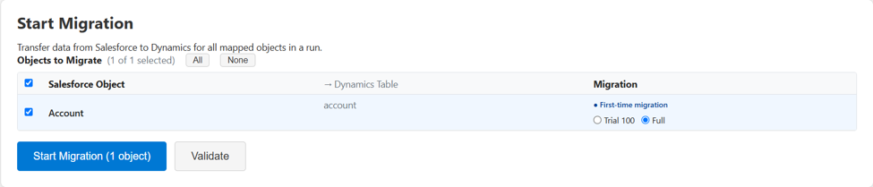

1. Select **Validate** to check the mapping before the run, and then confirm that the validation passes.

    

1. Select **Start Migration (1 object)**, review the **Migration Preview**, and then select the consent check box and **Confirm & Start Migration**.

    

1. Monitor **Current migration** until the status shows as complete.

    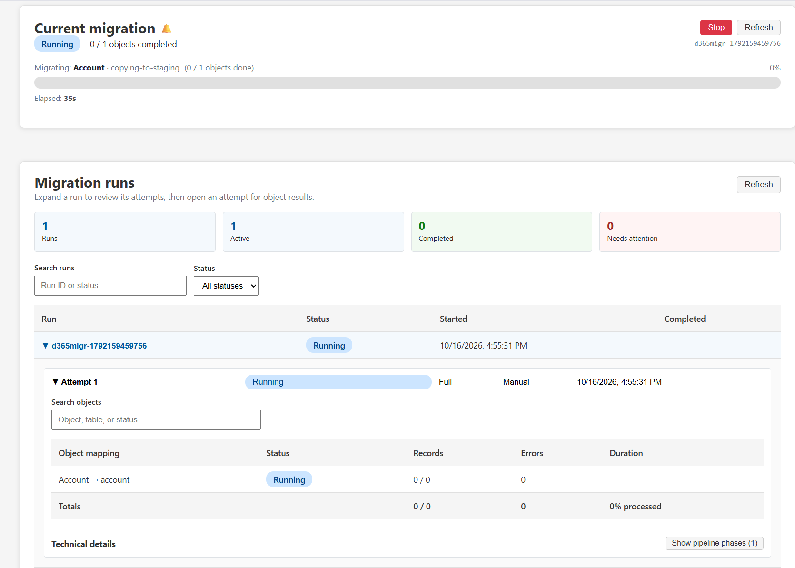

===

## Task 4: Validate the migrated Account records

The **Dashboard** compares record counts and samples field values, so you can confirm that the migration is complete and accurate.

1. In the left navigation, select **Dashboard** to open the **Dashboard** page.

1. In **Refresh Dashboard**, leave **Skip count reconciliation** and **Skip field sampling** cleared, and then select **Refresh** to reconcile counts and sample fields.

    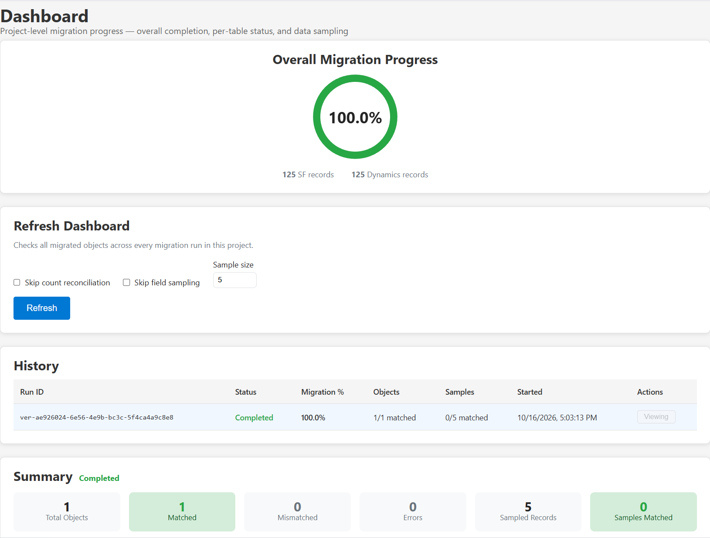

1. In the **Summary** and **Count Reconciliation** sections, locate the **Account** row, and then confirm that **SF Count** and **Dynamics After** are the same and that the status is **Matched**.

    

1. In Dynamics 365 Sales, open the **Accounts** list, and then spot-check a few migrated records against Salesforce.

    

**Checkpoint:** The Account count in Dynamics 365 matches Salesforce, and the sampled fields match.
