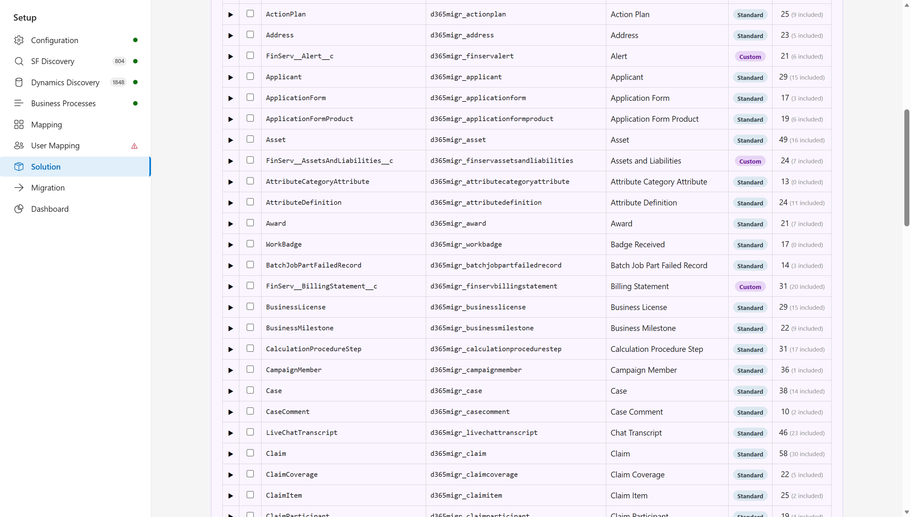
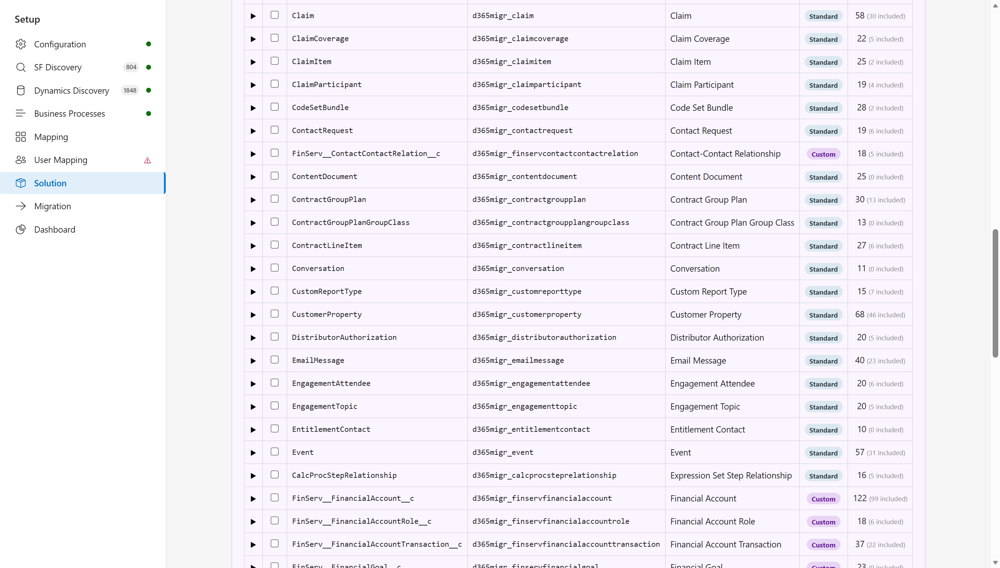
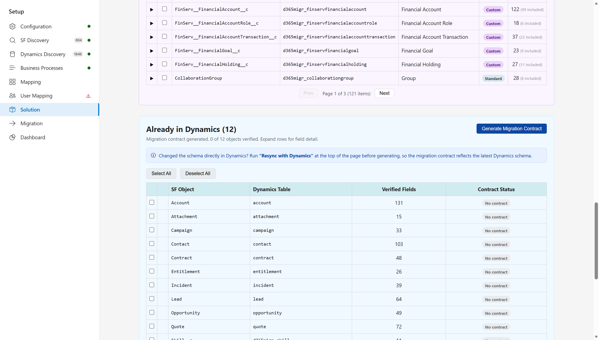
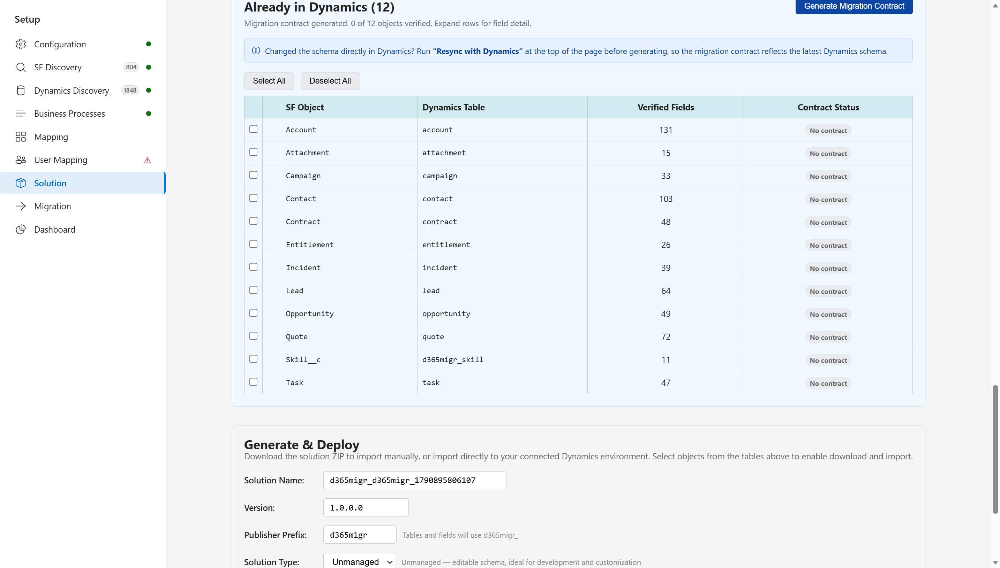
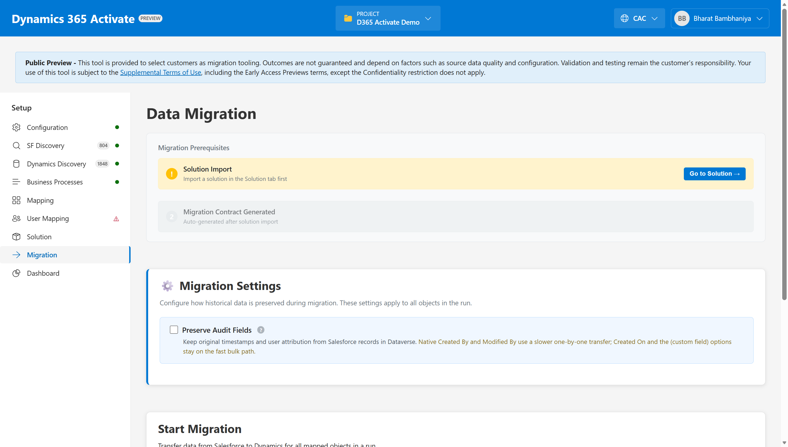
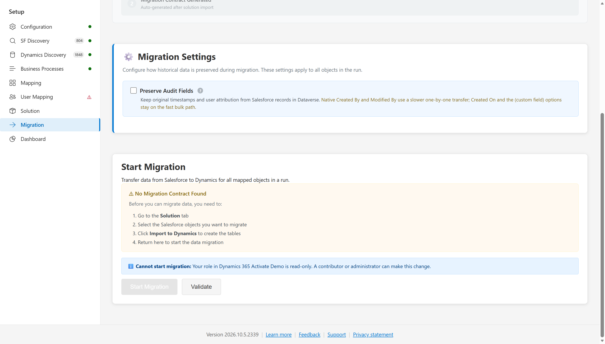
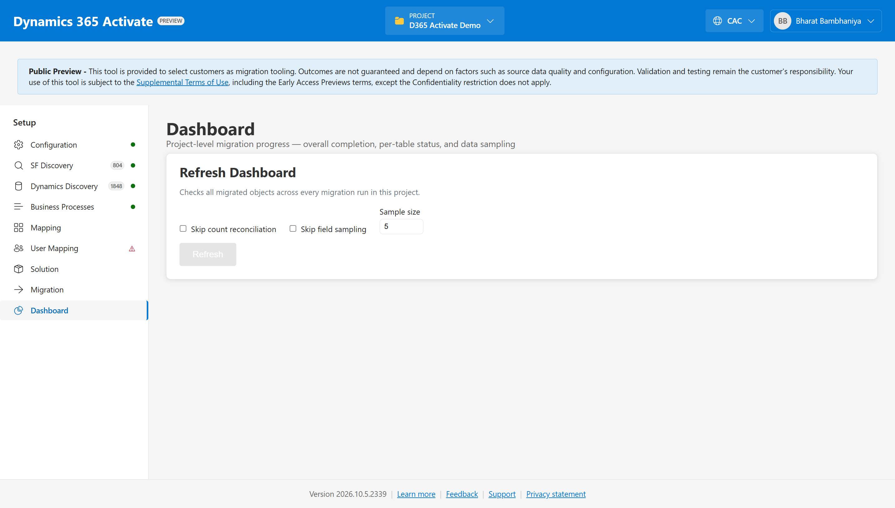

# Exercise 5: Migrate the Account records

In this exercise, you map the Salesforce **Account** object to the existing Dynamics 365 `account` table, generate the migration contract, run the migration, and validate the result on the dashboard.

> **Authoring note:** The screenshots marked **Screenshot pending** require a project in which the signed-in user has the contributor or administrator role. Capture them with the same naming convention, and then replace each pending line with the image link.

## Task 1: Review the Mapping Workbench

The **Mapping Workbench** is where you generate and approve the field mappings between Salesforce and Dynamics 365.

1. In the left navigation, select **Mapping** to open the **Mapping Workbench**.

1. In the **Generate & Review Mappings** card, review the toolbar buttons, such as **Auto-Generate Mappings**, **Load Mappings**, **Preflight Check**, **Templates**, **Reuse Hub**, **Annotations**, **Export**, **Import**, **History**, and **Global Picklists**.

    

    > **Note:** The workbench shows **No Mappings Yet** until you generate mappings.

1. In the toolbar, select **Auto-Generate Mappings** to create field mappings for the in-scope objects.

    > **Screenshot pending:** `d365a-mapping-autogen01.png`

1. When generation finishes, in the mapping list, select **Account** to open its field mappings.

    > **Screenshot pending:** `d365a-mapping-acctmap01.png`

1. In the Account field mappings, review each Salesforce field and its Dynamics 365 target column, and then approve the mapping.

    > **Screenshot pending:** `d365a-mapping-acctmap02.png`

1. In the toolbar, select **Preflight Check** to confirm that no blocking issues remain before migration.

    > **Screenshot pending:** `d365a-mapping-preflight01.png`

===

## Task 2: Generate the migration contract for Account

Because Account already exists in Dynamics 365, Activate only needs a **migration contract** for it, and it does not create a new table.

1. In the left navigation, select **Solution** to open the **Dynamics Solution Generator**.

1. At the top of the page, review the tiles for **Objects Selected**, **Total Fields**, **New Tables**, and **Already in Dynamics**.

    

    > **Note:** The **New Tables** list holds Salesforce objects that have no matching Dynamics 365 table, so Account does not appear there.

    

    

    

1. Scroll down to the **Already in Dynamics** table, and then locate the **Account** row that maps to the `account` table with 131 verified fields.

    

1. In the **Account** row, select the check box to include Account in the migration.

    > **Screenshot pending:** `d365a-solution-acctselect01.png`

1. Scroll down to the **Generate & Deploy** section, and review the solution name, version, publisher prefix, and solution type.

    

    > **Note:** If a red **Failed to check missing columns** banner appears, select **Resync with Dynamics** at the top of the page, and then check again.

1. In the **Generate & Deploy** section, select **Import to Dynamics** to import the solution into your connected Dynamics 365 environment.

    > **Screenshot pending:** `d365a-solution-import01.png`

1. Scroll up to the **Already in Dynamics** table, select **Generate Migration Contract** if the **Contract Status** for Account still shows **No contract**, and then confirm that the status changes.

    > **Screenshot pending:** `d365a-solution-contract01.png`

    > **Authoring note:** The Migration page states that the contract is auto-generated after the solution import, so verify with a contributor account whether the **Generate Migration Contract** step is still required, and update this task to match.

    > **Why this matters:** The **Migration** page stays blocked until the solution import is complete and the migration contract exists.

===

## Task 3: Run the Account migration

The **Migration** page runs the data transfer for all mapped objects, so you review the settings before you start.

1. In the left navigation, select **Migration** to open the **Data Migration** page.

1. In **Migration Prerequisites**, confirm that **Solution Import** and **Migration Contract Generated** are both complete.

    

    > **Note:** In the read-only demo project, **Solution Import** shows a warning and **Go to Solution** appears, because no contract has been generated yet.

1. In **Migration Settings**, decide whether to select **Preserve Audit Fields**, which keeps the original Salesforce timestamps and user attribution.

    > **Why this matters:** Preserving the native **Created By** and **Modified By** values uses a slower one-by-one transfer, so select it only when you need that history.

1. Scroll down to the **Start Migration** section.

    

1. Select **Start Migration** to transfer the Account records from Salesforce to Dynamics 365.

    > **Screenshot pending:** `d365a-migrate-run01.png`

1. Monitor the run until it shows as complete.

    > **Screenshot pending:** `d365a-migrate-run02.png`

===

## Task 4: Validate the migrated Account records

The **Dashboard** compares record counts and samples field values, so you can confirm that the migration is complete and accurate.

1. In the left navigation, select **Dashboard** to open the **Dashboard** page.

1. In **Refresh Dashboard**, review the **Skip count reconciliation**, **Skip field sampling**, and **Sample size** options.

    

1. Leave both skip options cleared, and then select **Refresh** to reconcile counts and sample fields for the migrated objects.

    > **Screenshot pending:** `d365a-dashboard-refresh01.png`

1. In the results, locate the **Account** row, and then confirm that the Dynamics 365 record count matches the 287 Salesforce records.

    > **Screenshot pending:** `d365a-dashboard-acctresult01.png`

1. In Dynamics 365 Sales, open the **Accounts** list, and then spot-check a few migrated records against Salesforce.

    > **Screenshot pending:** `d365a-dashboard-acctverify01.png`

**Checkpoint:** The Account count in Dynamics 365 matches Salesforce, and the sampled fields match.
