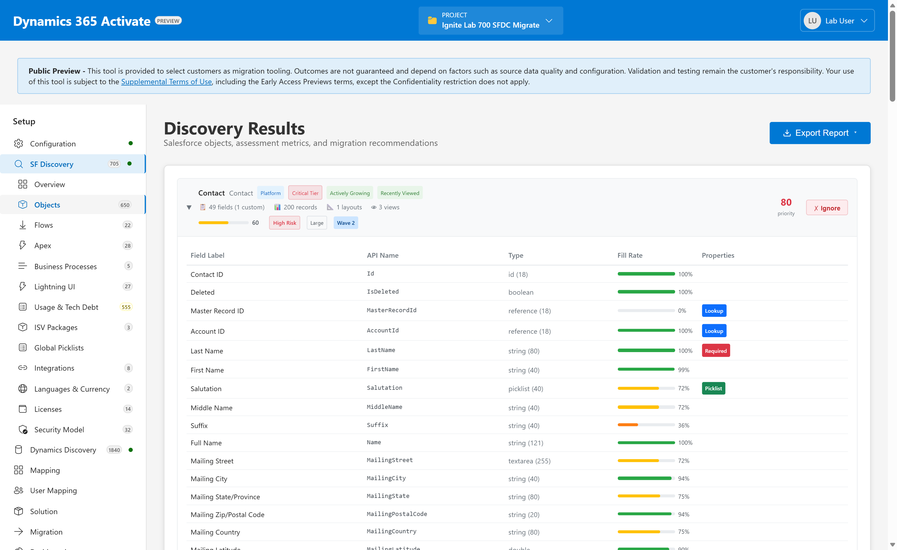
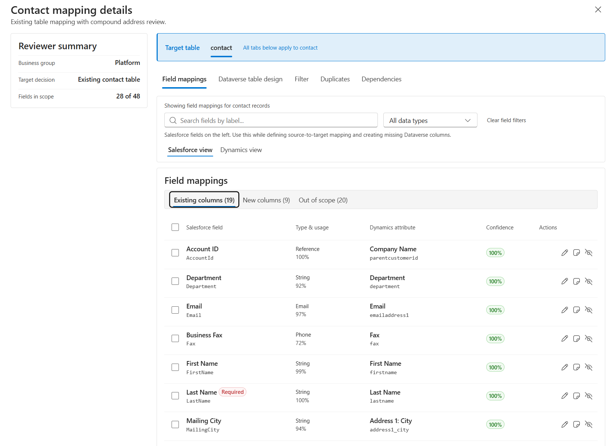
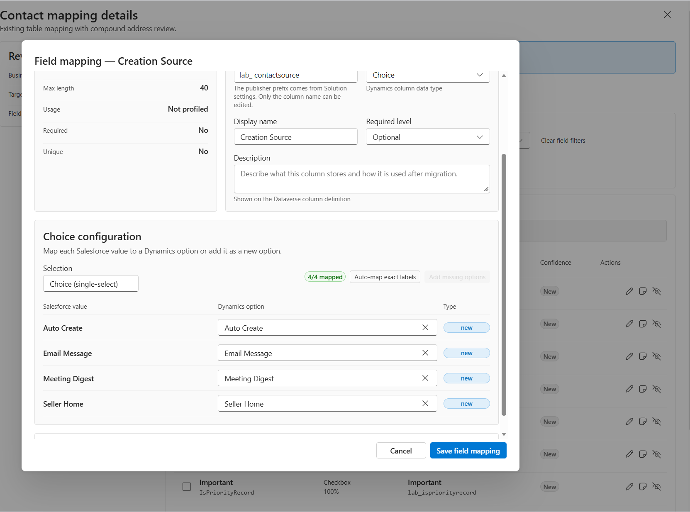
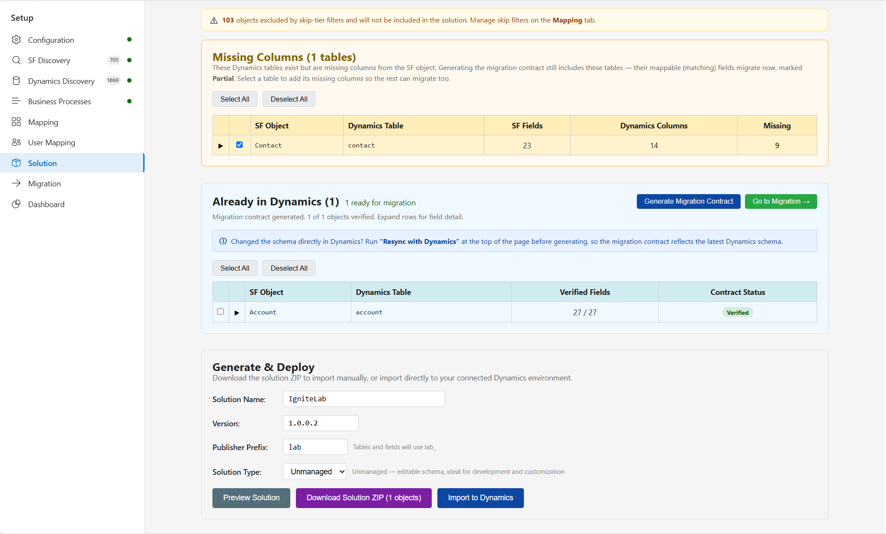
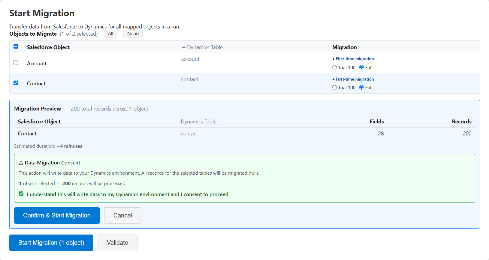
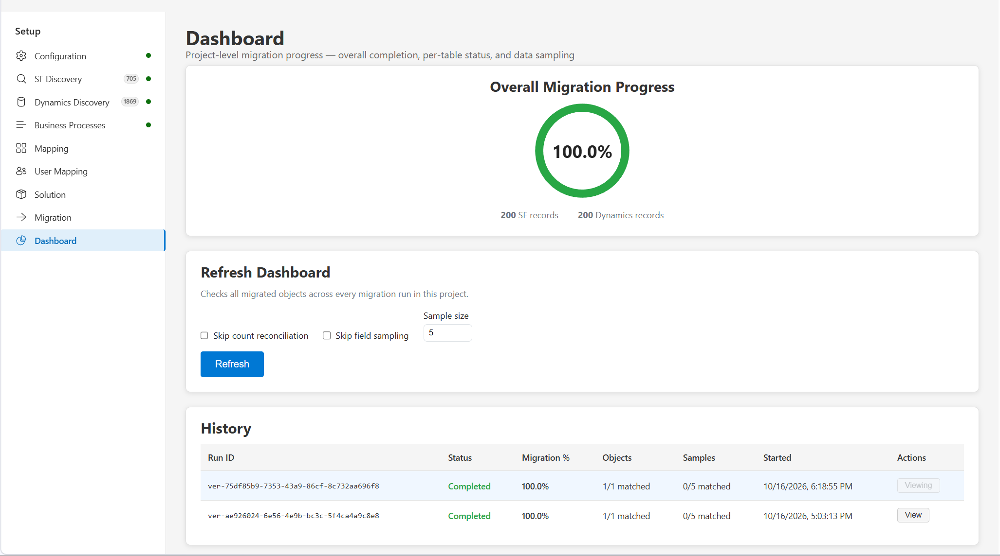
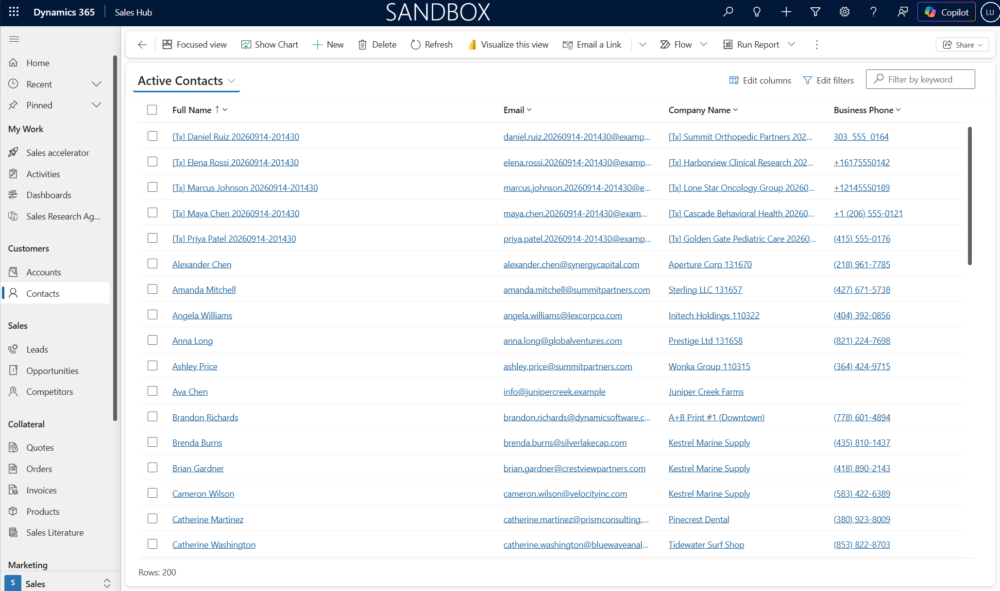
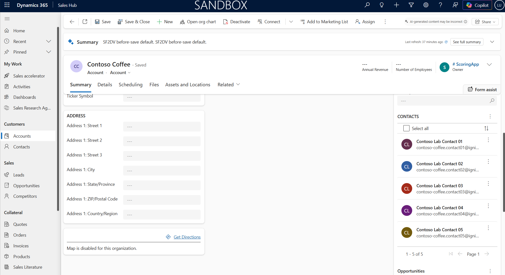

# Exercise 6: Migrate the Contact records

In this exercise, you inspect the Salesforce **Contact** object, confirm its target `contact` table in Dynamics 365, and then migrate the Contact records. Contact looks up to Account, so you complete Exercise 5 first.

## Task 1: Inspect the Contact object

The object details panel shows how complex the Contact migration is, so you know what to check when you map and validate it.

1. In the left navigation, select **SF Discovery**, and then select **Objects**.

1. Locate the **Contact** row, and then select **Open details** to display the details panel on the right side of the page.

1. In the panel header, confirm that the description reads **Standard object in the Platform business area**.

1. In the **Recommendation summary** card, note the **Scope decision**, the **Business priority** score, and the **Complexity** score.

1. On the **Overview** tab, review the **Record types**, **Volume & usage**, and **Customization summary**.

    > **Why this matters:** Skipping unused fields and deciding how to handle formula fields keeps the mapping smaller and the load faster.

===

## Task 2: Review Contact relationships and fields

The fields table in the expanded Contact row shows the lookups Contact depends on and which fields must have a value in Dynamics 365.

1. In the expanded **Contact** row, scroll down to the fields table.

1. Near the top of the table, locate **Last Name** (`LastName`), which carries the **Required** property, and **Account ID** (`AccountId`) and **Master Record ID** (`MasterRecordId`), which carry the **Lookup** property.

    

    > **Note:** The **Lookup** fields are the parent tables that Contact points to. **Account ID** is filled in for 100% of the contacts, and **Master Record ID** is a self-reference to another Contact.

    > **Note:** Contacts that are linked to Accounts need Exercise 5 to be complete, so that the lookup resolves. See [Migrate the Account records](05-account-migration.md).

1. Scroll down to locate **Email** (`Email`), and then check its **Fill Rate**.

1. Select the arrow at the left of the **Contact** row to collapse it.

    > **Important:** Do not select **Ignore**, because it would move Contact out of the migration scope.

===

## Task 3: Confirm the target Contact table in Dynamics 365

Contact is a standard table in Dynamics 365, so Activate migrates into the existing `contact` table instead of creating a new one.

1. In the left navigation, select **Dynamics Discovery**.

1. In the search box under the filters, enter **contact**.

1. Locate the **Contact** (`contact`) table, which is marked **Standard** and **UserOwned**.

    

1. Select **Clear filters** to reset the entity list.

    > **Important:** Do not expand the rows or select **Preload Attributes**, because they query your Dynamics environment.

===

## Task 4: Map, migrate, and validate the Contact records

You use the same pages as the Account migration, so this task lists only what is different for Contact. Use Exercise 5 for the full steps on each page: [Migrate the Account records](05-account-migration.md).

1. In the left navigation, select **Mapping**, and then open the **Contact → contact** mapping details.

1. On the **Field mappings** tab, confirm that **Last Name** and **Email** each have a target column on the `contact` table, and that **Account ID** maps to the parent account lookup.

    

1. Check every field that shows an alert, and then review the picklist mappings.

    

1. In the left navigation, select **Solution**, select the check box in the **Contact** row of **Missing Columns**, and then follow Task 2 of Exercise 5 to import the solution.

    

1. In the left navigation, select **Migration**, and then confirm that the prerequisites are complete.

1. In **Migration Settings**, keep the audit field options that you selected in Exercise 5.

1. In **Objects to Migrate**, select **Contact**, clear **Account**, and then select **Validate**.

1. Select **Start Migration**, select the consent check box and **Confirm & Start Migration**, and then monitor the run until it shows as complete.

    

    > **Why this matters:** **Start Migration** transfers every selected object in the run, so clear **Account** to migrate only Contact.

1. When the run completes, in the left navigation, select **Dashboard**, and then select **Refresh**.

1. In the results, locate the **Contact** row, and then confirm that the Dynamics 365 record count matches the Salesforce record count.

    

1. In Dynamics 365 Sales, open the **Active Contacts** list, and then open a few migrated records to confirm that each one shows its full name and email.

    

1. Open the **Contoso Coffee** account, and then confirm that the five migrated contacts are associated with it.

    

**Checkpoint:** The Contact count in Dynamics 365 matches Salesforce, and the sampled Contacts show the correct name and email and are associated with their accounts.
