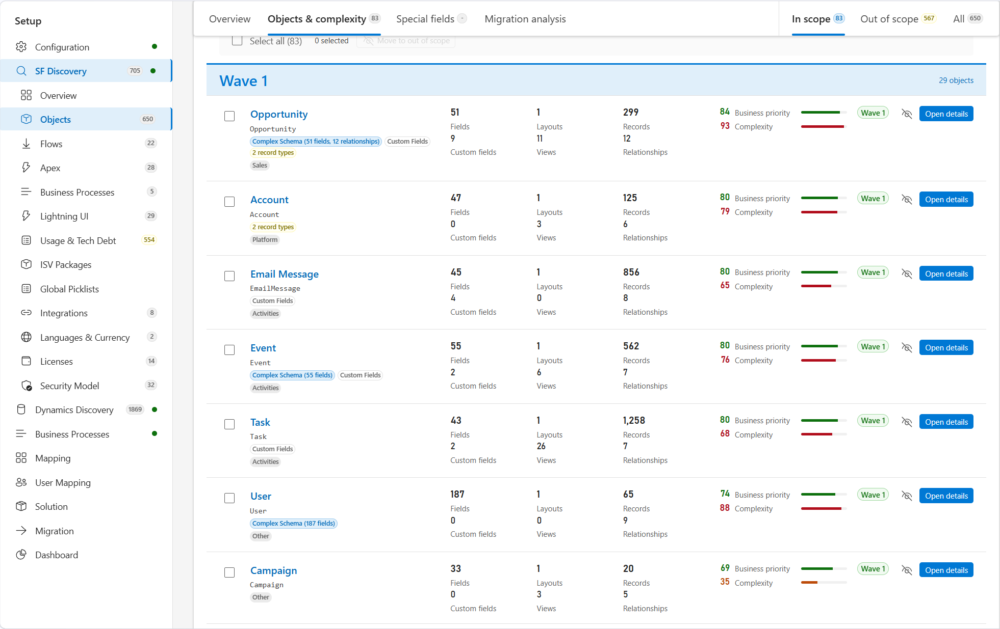
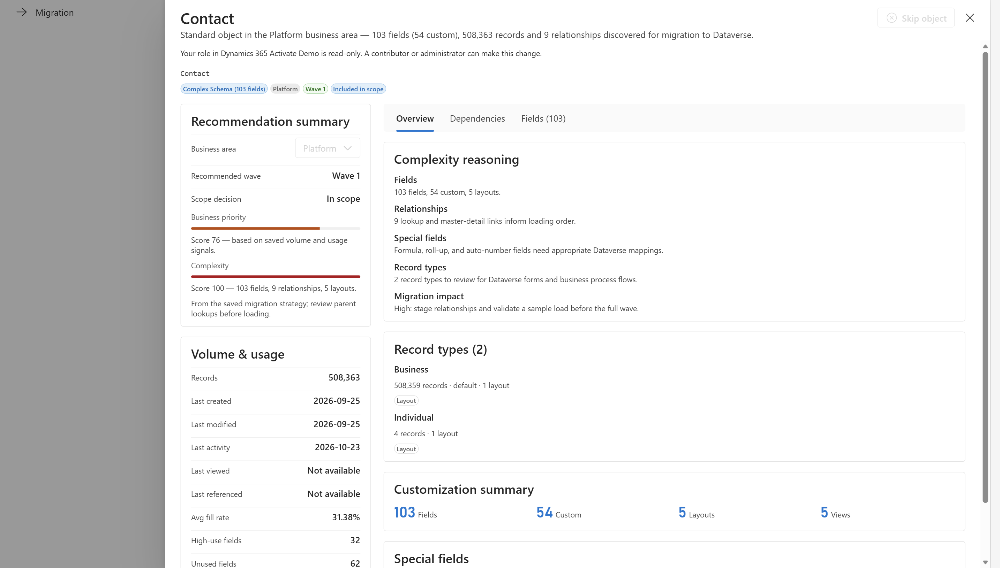
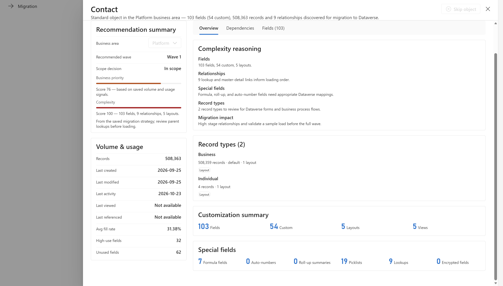
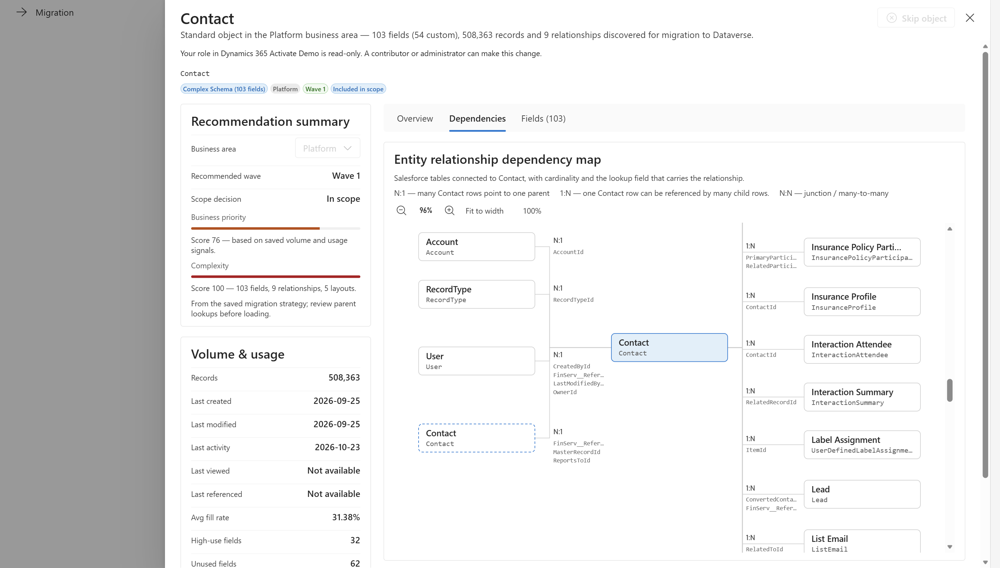
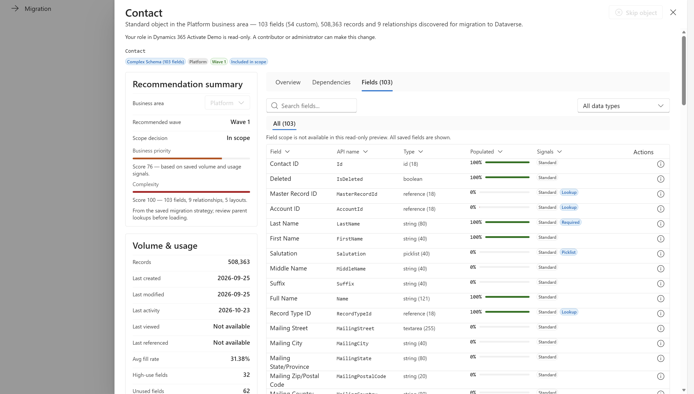
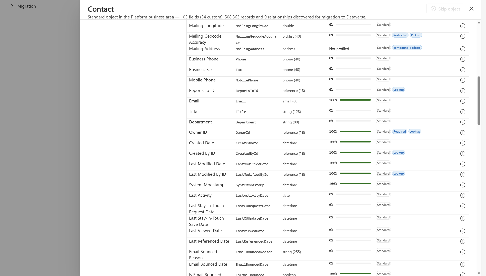
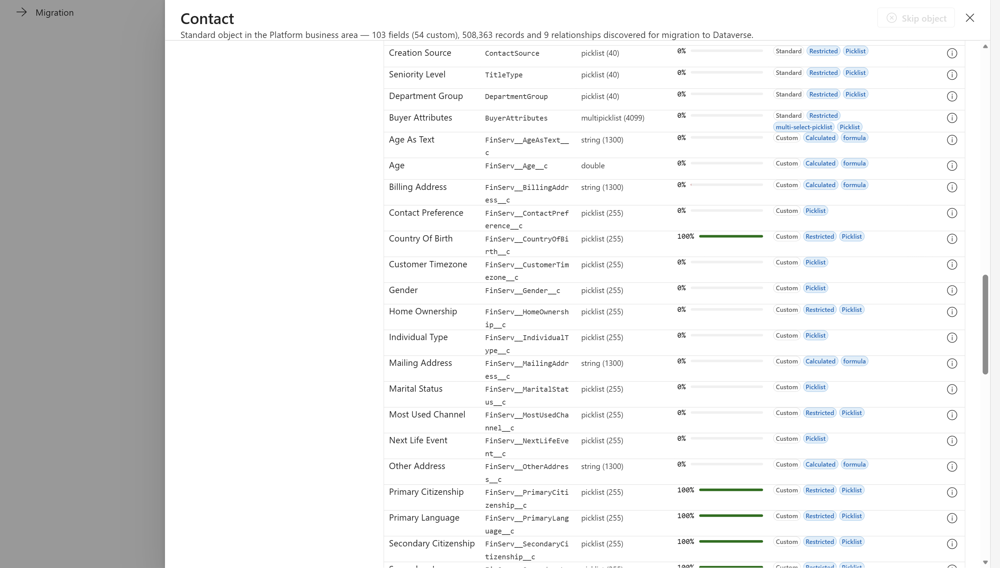
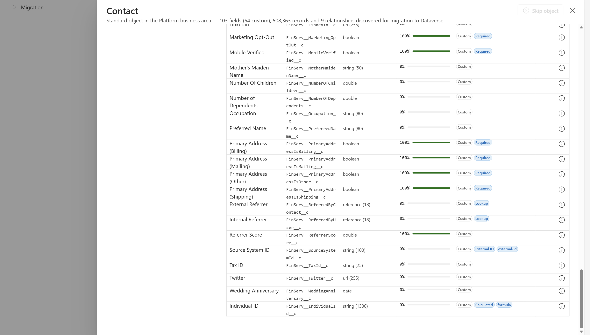
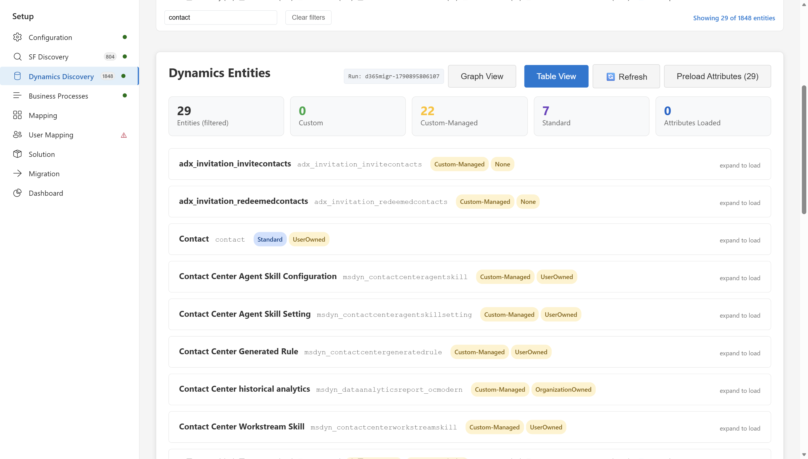
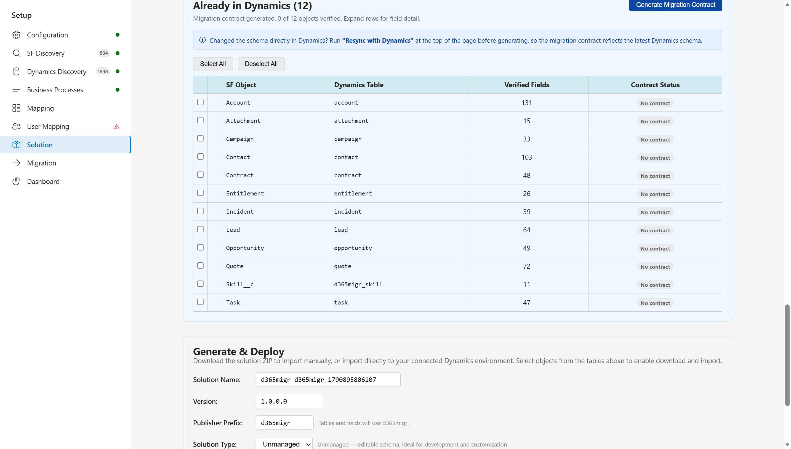

# Exercise 6: Migrate the Contact records

In this exercise, you inspect the Salesforce **Contact** object, confirm its target `contact` table in Dynamics 365, and then migrate the Contact records. Contact is the largest object in this lab, with more than 500,000 records, so you focus on volume, required fields, and parent lookups before you start the run.

> **Authoring note:** The screenshots marked **Screenshot pending** require a project in which the signed-in user has the contributor or administrator role. Capture them with the same naming convention, and then replace each pending line with the image link.

## Task 1: Inspect the Contact object

The object details panel shows how big and how complex the Contact migration is, so you know what to check when you map and validate it.

1. In the left navigation, select **SF Discovery**, and then select **Objects**.

1. Scroll down to the **Wave 1** group, and then locate the **Contact** row.

    

1. In the **Contact** row, select **Open details** to display the details panel on the right side of the page.

1. In the panel header, confirm that the description reads **Standard object in the Platform business area — 103 fields (54 custom), 508,363 records and 9 relationships discovered for migration to Dataverse**.

1. In the **Recommendation summary** card, note the **Recommended wave** (**Wave 1**), the **Scope decision** (**In scope**), the **Business priority** score (**76**), and the **Complexity** score (**100**).

    

1. On the **Overview** tab, review the two **Record types**: **Business**, which holds almost all the records, and **Individual**, which holds 4 records.

1. Scroll down in the panel to review **Volume & usage**, the **Customization summary**, and **Special fields**.

    

    > **Why this matters:** Contact has an **Avg fill rate** of 31.38% and 62 **Unused fields**, and it has 7 **Formula fields**. Skipping unused fields and deciding how to handle formula fields keeps the mapping smaller and the load faster.

===

## Task 2: Review Contact dependencies and fields

The **Dependencies** tab shows the parent tables that Contact looks up to, and the **Fields** tab shows which fields must have a value in Dynamics 365.

1. In the details panel, select the **Dependencies** tab to display the **Entity relationship dependency map**.

1. In the map, review the four **N:1** parent tables on the left: **Account** (`AccountId`), **RecordType** (`RecordTypeId`), **User** (`OwnerId`), and **Contact** (`ReportsToId`).

    

    > **Note:** The dashed **Contact** box is a self-reference. One Contact can report to another Contact through **Reports To ID**, so both records must exist before that lookup can be set.

1. In the details panel, select the **Fields (103)** tab to display every Contact field.

1. Near the top of the **Fields** table, locate **Last Name** (`LastName`), which carries the **Required** signal, and **Account ID** (`AccountId`), which carries the **Lookup** signal.

    

    > **Note:** In the demo data, **Account ID** shows **0%** populated. Check the value for your own org. If your Contacts are linked to Accounts, complete [Exercise 5: Migrate the Account records](05-account-migration.md) first so the lookup resolves.

1. Scroll down to locate **Email** (`Email`), which is **100%** populated, and **Owner ID** (`OwnerId`), which carries the **Required** and **Lookup** signals.

    

    > **Why this matters:** Every Contact needs an owner. **Owner ID** maps to a Dynamics 365 user, so Contact ownership depends on the user matching that you reviewed in [Exercise 4](04-dynamics-and-user-mapping.md#task-3-review-user-mapping).

1. Continue scrolling to the `FinServ__` custom fields, and then locate the fields with the **Calculated** and **formula** signals, such as **Age As Text**, **Age**, and **Billing Address**.

    

    > **Note:** Formula fields are calculated in Salesforce at read time. Decide whether to recreate them as calculated columns in Dynamics 365 or to leave them unmapped.

1. Scroll down to the end of the **Fields** table, and then locate **Source System ID** (`FinServ__SourceSystemId__c`), which carries the **External ID** signal.

    

    > **Note:** The required custom check boxes, such as **Marketing Opt-Out** and **Primary Address (Billing)**, are 100% populated, so they need a target column in Dynamics 365.

1. In the upper-right corner of the panel, select **Close object details** (**X**) to close the panel.

    > **Important:** Do not select **Skip object**, because it would move Contact out of the migration scope.

===

## Task 3: Confirm the target Contact table in Dynamics 365

Contact is a standard table in Dynamics 365, so Activate migrates into the existing `contact` table instead of creating a new one.

1. In the left navigation, select **Dynamics Discovery**.

1. In the search box under the filters, enter **contact**.

1. Confirm that the page shows **Showing 29 of 1848 entities**, and then locate the **Contact** (`contact`) table, which is marked **Standard** and **UserOwned**.

    

1. Select **Clear filters** to reset the entity list.

    > **Important:** Do not expand the rows or select **Preload Attributes**, because they query your Dynamics environment.

1. In the left navigation, select **Solution**, and then scroll down to the **Already in Dynamics** table.

1. Locate the **Contact** row, which maps to the `contact` table with 103 verified fields and shows **No contract**.

    

===

## Task 4: Map, migrate, and validate the Contact records

You use the same pages as the Account migration, so this task lists only what is different for Contact. Use [Exercise 5](05-account-migration.md) for the full steps on each page.

1. In the left navigation, select **Mapping**, and then follow [Task 1 of Exercise 5](05-account-migration.md#task-1-review-the-mapping-workbench) to generate the mappings.

1. In the mapping list, select **Contact** to open its field mappings.

    > **Screenshot pending:** `contact/d365a-mapping-conmap01.png`

1. In the Contact field mappings, confirm that **Last Name**, **Email**, and **Owner ID** each have a target column on the `contact` table, and that **Account ID** maps to the parent account lookup. Then approve the mapping.

    > **Screenshot pending:** `contact/d365a-mapping-conmap02.png`

1. In the left navigation, select **Solution**. In the **Already in Dynamics** table, select the check box in the **Contact** row, and then follow [Task 2 of Exercise 5](05-account-migration.md#task-2-generate-the-migration-contract-for-account) to import the solution and generate the migration contract.

    > **Screenshot pending:** `contact/d365a-solution-conselect01.png`

1. In the left navigation, select **Migration**, and then confirm that the prerequisites are complete.

1. In **Migration Settings**, leave **Preserve Audit Fields** cleared unless you need the original **Created By** and **Modified By** values.

    > **Why this matters:** Preserving the native **Created By** and **Modified By** values uses a slower one-by-one transfer. With more than 500,000 Contact records, that can make the run much longer.

1. Select **Start Migration**, and then monitor the run until it shows as complete.

    > **Note:** **Start Migration** transfers all mapped objects in the run. Opportunity looks up to Contact through **Contact ID**, so you complete this Contact migration before you migrate Opportunity in [Exercise 7](07-opportunity-migration.md).

    > **Screenshot pending:** `contact/d365a-migrate-conrun01.png`

1. When the run completes, in the left navigation, select **Dashboard**, and then select **Refresh**.

1. In the results, locate the **Contact** row, and then confirm that the Dynamics 365 record count matches the 508,363 Salesforce records.

    > **Screenshot pending:** `contact/d365a-dashboard-conresult01.png`

1. In Dynamics 365 Sales, open the **Contacts** list, open a few migrated records, and then confirm that each one shows its full name, email, and owner.

    > **Screenshot pending:** `contact/d365a-dashboard-converify01.png`

**Checkpoint:** The Contact count in Dynamics 365 matches Salesforce, and the sampled Contacts show the correct name, email, and owner.
