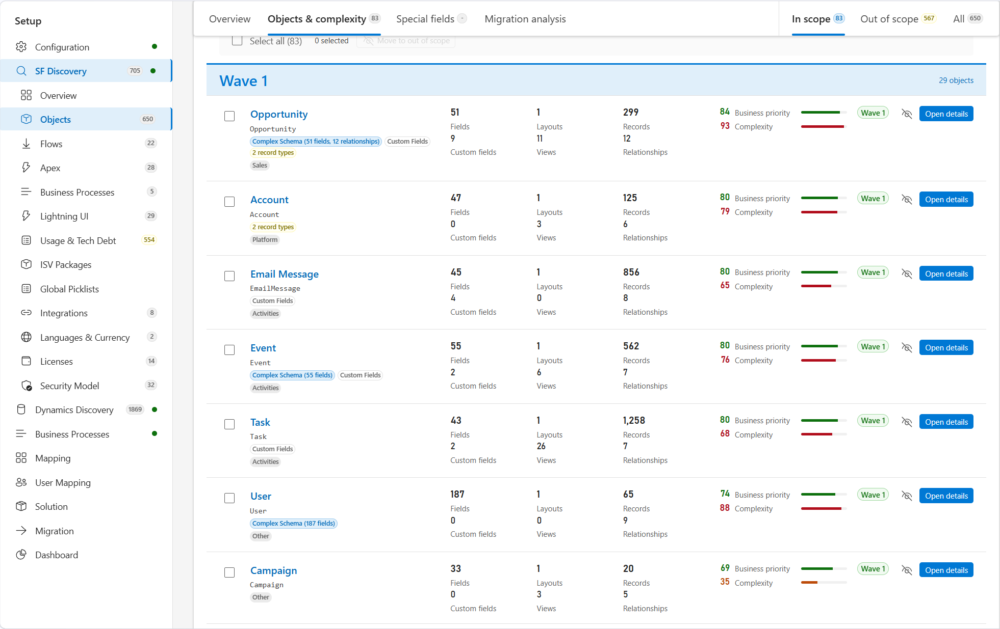
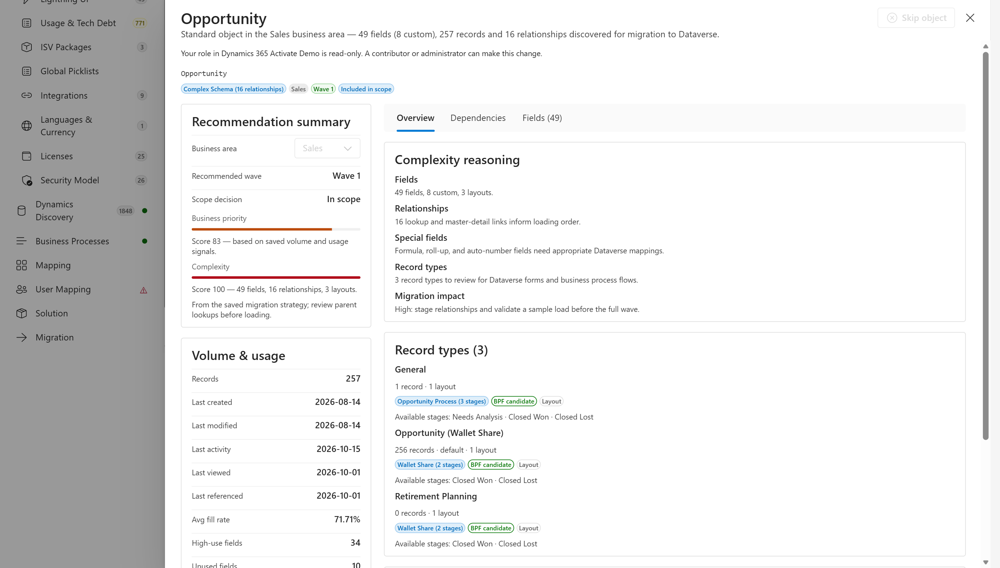
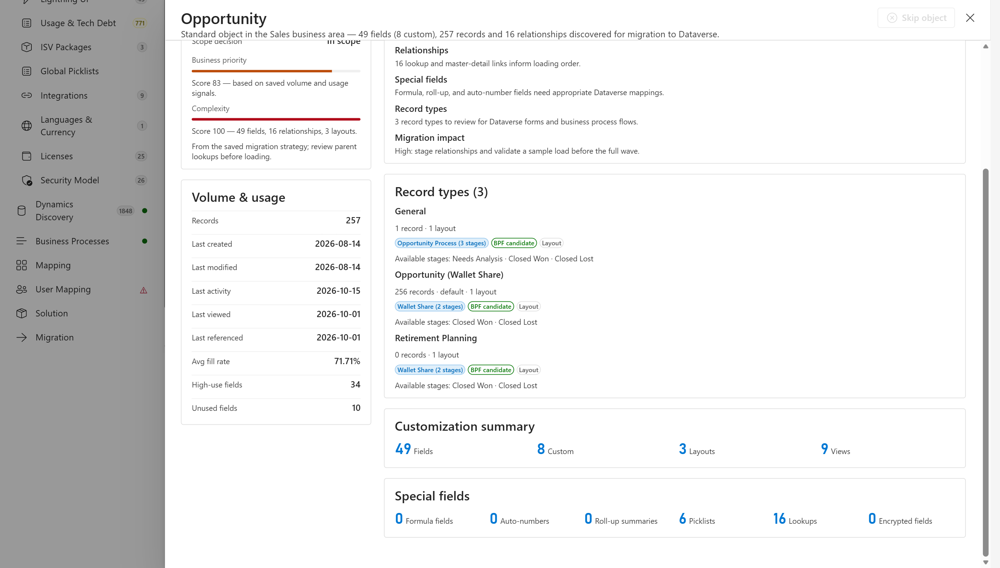
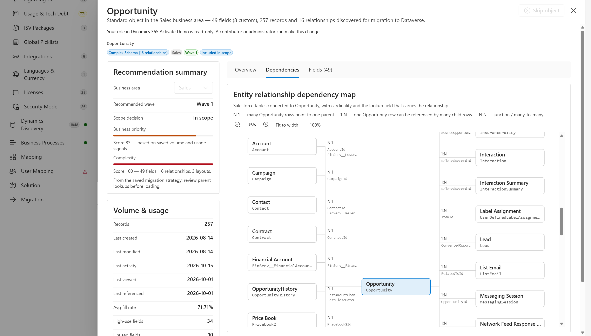
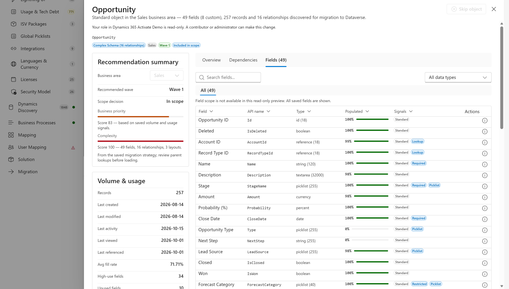
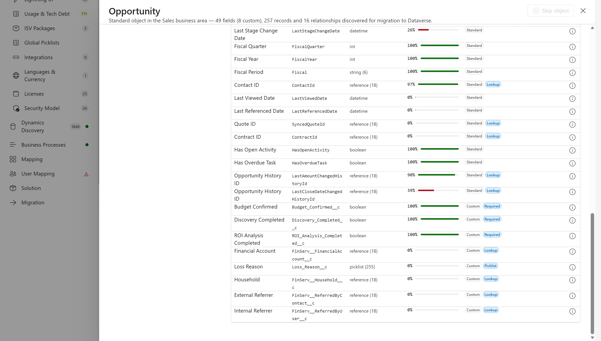
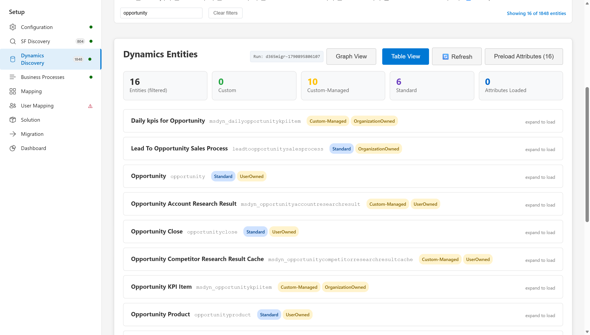
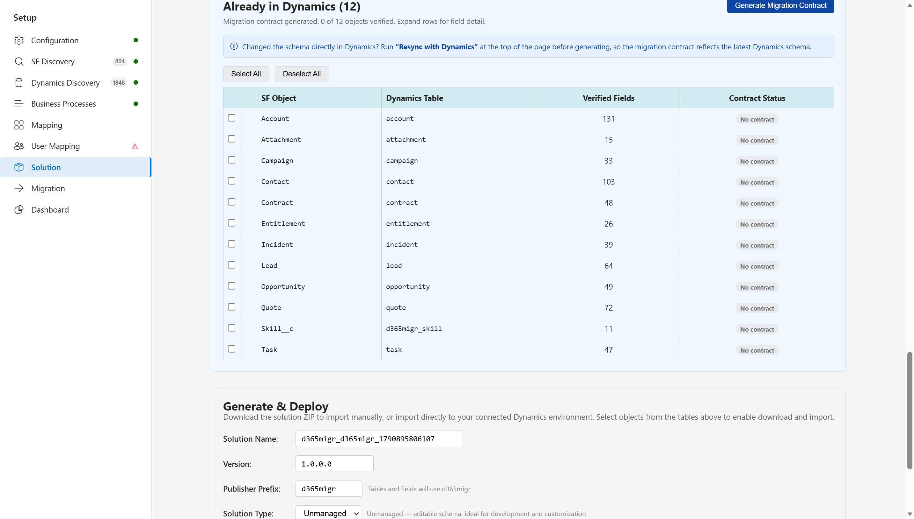

# Exercise 7: Migrate the Opportunity records

In this exercise, you inspect the Salesforce **Opportunity** object, confirm its target `opportunity` table in Dynamics 365, and then migrate the Opportunity records. Each Opportunity points to a parent Account and a Contact, so you complete [Exercise 5: Migrate the Account records](05-account-migration.md) and [Exercise 6: Migrate the Contact records](06-contact-migration.md) before you start.

> **Authoring note:** The screenshots marked **Screenshot pending** require a project in which the signed-in user has the contributor or administrator role. Capture them with the same naming convention, and then replace each pending line with the image link.

## Task 1: Inspect the Opportunity object

The object details panel shows how big and how complex the Opportunity migration is, so you know what to check when you map and validate it.

1. In the left navigation, select **SF Discovery**, and then select **Objects**.

1. Scroll down to the **Wave 1** group, and then locate the **Opportunity** row at the top of the group.

    

1. In the **Opportunity** row, select **Open details** to display the details panel on the right side of the page.

1. In the panel header, confirm that the description reads **Standard object in the Sales business area — 49 fields (8 custom), 257 records and 16 relationships discovered for migration to Dataverse**.

1. In the **Recommendation summary** card, note the **Recommended wave** (**Wave 1**), the **Scope decision** (**In scope**), the **Business priority** score (**83**), and the **Complexity** score (**100**).

    

1. On the **Overview** tab, review the three **Record types**: **General**, **Opportunity (Wallet Share)**, and **Retirement Planning**.

    > **Note:** Each record type is tagged as a **BPF candidate**, because its sales stages, such as **Needs Analysis**, **Closed Won**, and **Closed Lost**, can become a business process flow in Dynamics 365.

1. Scroll down in the panel to review **Volume & usage**, the **Customization summary**, and **Special fields**.

    

    > **Why this matters:** Opportunity has 16 lookups and no formula or roll-up fields, so the migration risk sits in the relationships rather than in calculated fields.

===

## Task 2: Review Opportunity dependencies and fields

The **Dependencies** tab shows the parent tables that Opportunity looks up to, which tells you what must be migrated first.

1. In the details panel, select the **Dependencies** tab to display the **Entity relationship dependency map**.

1. In the map, scroll up to the top of the **N:1** parent tables on the left, and then locate **Account**, which is connected through the `AccountId` field.

    

    > **Why this matters:** N:1 means many Opportunity rows point to one parent row. The parent Account records must already exist in Dynamics 365, or the Opportunity lookups can't be resolved during migration.

1. In the details panel, select the **Fields (49)** tab to display every Opportunity field.

1. In the **Fields** table, locate the fields with the **Required** signal: **Name**, **Stage** (`StageName`), and **Close Date** (`CloseDate`).

1. Notice that **Account ID** (`AccountId`) is **99%** populated and carries the **Lookup** signal.

    

1. Scroll down to the end of the **Fields** table to review the custom fields.

    

    > **Note:** The three required custom check boxes, **Budget Confirmed**, **Discovery Completed**, and **ROI Analysis Completed**, are 100% populated, while the `FinServ__` lookups are 0% populated and are candidates to skip.

1. In the upper-right corner of the panel, select **Close object details** (**X**) to close the panel.

    > **Important:** Do not select **Skip object**, because it would move Opportunity out of the migration scope.

===

## Task 3: Confirm the target Opportunity table in Dynamics 365

Opportunity is a standard table in Dynamics 365 Sales, so Activate migrates into the existing `opportunity` table instead of creating a new one.

1. In the left navigation, select **Dynamics Discovery**.

1. In the search box under the filters, enter **opportunity**.

1. Confirm that the page shows **Showing 16 of 1848 entities**, and then locate the **Opportunity** (`opportunity`) table, which is marked **Standard** and **UserOwned**.

    

    > **Note:** **UserOwned** means each Opportunity has an owner in Dynamics 365, which is why the user matching in [Exercise 4](04-dynamics-and-user-mapping.md) matters for this object.

1. Select **Clear filters** to reset the entity list.

    > **Important:** Do not expand the rows or select **Preload Attributes**, because they query your Dynamics environment.

1. In the left navigation, select **Solution**, and then scroll down to the **Already in Dynamics** table.

1. Locate the **Opportunity** row, which maps to the `opportunity` table with 49 verified fields and shows **No contract**.

    

===

## Task 4: Map, migrate, and validate the Opportunity records

You use the same pages as the Account migration, so this task lists only what is different for Opportunity. Use [Exercise 5](05-account-migration.md) for the full steps on each page.

1. In the left navigation, select **Mapping**, and then follow [Task 1 of Exercise 5](05-account-migration.md#task-1-review-the-mapping-workbench) to generate the mappings.

1. In the mapping list, select **Opportunity** to open its field mappings.

    > **Screenshot pending:** `opportunity/d365a-mapping-oppmap01.png`

1. In the Opportunity field mappings, confirm that **Account ID** (`AccountId`) maps to an account lookup column on the `opportunity` table, and that **Name**, **Stage**, and **Close Date** each have a target column, and then approve the mapping.

    > **Screenshot pending:** `opportunity/d365a-mapping-oppmap02.png`

1. In the left navigation, select **Solution**. In the **Already in Dynamics** table, select the check box in the **Opportunity** row, and then follow [Task 2 of Exercise 5](05-account-migration.md#task-2-generate-the-migration-contract-for-account) to import the solution and generate the migration contract.

    > **Screenshot pending:** `opportunity/d365a-solution-oppselect01.png`

1. In the left navigation, select **Migration**, confirm that the prerequisites are complete, and then select **Start Migration**.

    > **Note:** **Start Migration** transfers all mapped objects in the run. Make sure the Account records from Exercise 5 and the Contact records from Exercise 6 are already in Dynamics 365, or include them in the same run, so the Opportunity lookups resolve.

    > **Screenshot pending:** `opportunity/d365a-migrate-opprun01.png`

1. When the run completes, in the left navigation, select **Dashboard**, and then select **Refresh**.

1. In the results, locate the **Opportunity** row, and then confirm that the Dynamics 365 record count matches the 257 Salesforce records.

    > **Screenshot pending:** `opportunity/d365a-dashboard-oppresult01.png`

1. In Dynamics 365 Sales, open the **Opportunities** list, open a few migrated records, and then confirm that each one shows its parent account, stage, and close date.

    > **Screenshot pending:** `opportunity/d365a-dashboard-oppverify01.png`

**Checkpoint:** The Opportunity count in Dynamics 365 matches Salesforce, and the migrated Opportunities are linked to their parent accounts.
